# TỔNG HỢP DANH SÁCH CHỨC NĂNG CHUẨN HÓA & PHÂN CÔNG ĐỒ ÁN GREENSPOT

> **Dự án**: Hệ thống Tiếp nhận Phản ánh Ô nhiễm Môi trường Đô thị (GreenSpot)  
> **Phiên bản điều chỉnh**: Tinh gọn, thực tế, dễ thực hiện 100%, không đao to búa lớn, không trùng lặp giữa các thành viên.

---

> **QUY CHUẨN ĐỊNH DẠNG HỌC THUẬN & TRÌNH BÀY BÁO CÁO (THESIS STYLE GUIDE)**:
> - **Phông chữ chuẩn (Font Family)**: Times New Roman (áp dụng cho in ấn luận văn) hoặc Segoe UI / Inter (áp dụng cho báo cáo điện tử).
> - **Cỡ chữ phân cấp (Font Sizes)**: Tiêu đề Báo cáo cấp 1 (`#`): **18pt, In Hoa Đậm**; Tiêu đề Mục lớn cấp 2 (`##`): **14pt, In Hoa Đậm**; Tiêu đề Phân hệ cấp 3 (`###`): **13pt, In Đậm**; Tiêu đề Chức năng cấp 4 (`####`): **13pt, In Đậm Nghiêng**; Nội dung văn bản (Body text): **12pt**, Giãn dòng 1.3 - 1.5; Bảng biểu & Chú thích: **11pt**.
> - **Quy tắc In Đậm (Bold)**: Dùng cho từ khóa định danh, mã chức năng, tác nhân chính, nhãn dữ liệu và các mốc thời gian cam kết.
> - **Quy tắc In Nghiêng (Italic)**: Dùng cho thuật ngữ kỹ thuật tiếng Anh trong ngoặc đơn, Chú thích Hình/Bảng, và câu văn bản thông điệp Modal/Thông báo hiển thị.
> - **Quy tắc Inline Code (`...`)**: Dùng cho mã phần tử giao diện (`UI_ID`), mã thông báo lỗi (`ERR_CODE`), tên trường / bảng CSDL và đường dẫn API.
> - **Đánh số Bảng & Hình chuẩn IEEE/ISO**: Hình ảnh được đánh số `*Hình 4.XX: ...*` (đặt dưới hình); Bảng đặc tả được đánh số `*Bảng 4.XX.1: Đặc tả thành phần giao diện...*` và `*Bảng 4.XX.2: Quy tắc kiểm tra và thông báo lỗi...*` (đặt trên bảng), loại bỏ hoàn toàn trùng lặp số hiệu.

---

## I. BẢNG TỔNG QUAN PHÂN CÔNG 4 THÀNH VIÊN (48 CHỨC NĂNG)

*Bảng 1.1: Bảng tổng quan phân công nhiệm vụ 4 thành viên (48 chức năng nghiệp vụ)*
| STT | Thành Viên | MSSV | Vai Trò | Tên Phân Hệ Đảm Nhiệm | Phạm Vi Chức Năng |
| :---: | :--- | :---: | :--- | :--- | :---: |
| 1 | **Nguyễn Thành Đạt** | 24211TT0236 | Nhóm Phó | **Phân hệ Tiếp nhận phản ánh & Thu thập bằng chứng hiện trường** *(Citizen Incident Reporting)* | Chức năng 01 → 12 |
| 2 | **Huỳnh Anh Tú** | 24211TT0857 | Thành Viên | **Phân hệ Cộng đồng Xanh, Điểm thưởng & Tương tác công dân** *(Green Community & Gamification)* | **Chức năng 13 → 24** |
| 3 | **Bùi Nguyễn Minh Quân** | 24211TT1178 | Nhóm Trưởng | **Phân hệ Quản trị hệ thống, Cổng thông tin Cảnh báo môi trường & Giám sát công khai cho người dân** *(Admin Portal, Environmental Warning & Citizen Monitoring)* | **Chức năng 25 → 36** |
| 4 | **Lê Anh Tuấn** | 24211TT1250 | Thành Viên | **Phân hệ Phân tích số liệu, Nguy cơ ngập lụt & Trí tuệ nhân tạo** *(Smart Analytics & AI)* | Chức năng 37 → 48 |

---

## II. CHI TIẾT PHÂN HỆ HUỲNH ANH TÚ (CHỨC NĂNG 13 → 24)
> **Tên phân hệ mới**: **CỘNG ĐỒNG XANH, ĐIỂM THƯỞNG & TƯƠNG TÁC CÔNG DÂN**  
> **Đặc điểm**: Đổi hoàn toàn khỏi phân hệ WebGIS phức tạp; chuyển thành phân hệ giao diện tương tác cộng đồng thân thiện, dễ làm, khớp trực tiếp với các model CSDL `community.py` và `incident.py` có sẵn trong mã nguồn.

### Bảng tiến độ Chức năng 13 → 24 (Huỳnh Anh Tú)

*Bảng 2.1: Kế hoạch tiến độ thực hiện phân hệ Cộng đồng Xanh (Huỳnh Anh Tú - Chức năng 13 → 24)*
| STT | Tên Chức Năng Nghiệp Vụ | Hạn Hoàn Thành | Cách thức thực hiện trong Code (Rất dễ) | Bảng CSDL Tương Ứng |
| :---: | :--- | :---: | :--- | :--- |
| **13** | **Cơ chế tích lũy Điểm thưởng Công dân Xanh** *(Green Points Earning)* | 15/09/2026 | Khi sự cố được duyệt hoàn thành, gọi hàm cộng điểm tự động (+50 điểm) vào tài khoản công dân. | `users`, `reward_transactions` |
| **14** | **Xem số dư ví điểm và Lịch sử biến động điểm xanh** *(Points Balance & History)* | 22/09/2026 | Trang ví cá nhân: Hiển thị tổng điểm hiện có và bảng lịch sử cộng/trừ điểm theo thời gian. | `reward_transactions` |
| **15** | **Danh mục quà tặng xanh và Vật phẩm quy đổi** *(Eco-Reward Catalog)* | 29/09/2026 | Hiển thị danh sách thẻ card các phần quà (Ảnh, Tên quà, Số điểm cần đổi, Số lượng còn lại). | `citizen_rewards` |
| **16** | **Thực hiện đổi điểm lấy quà tặng / Voucher** *(Reward Redemption Process)* | 06/10/2026 | Người dân bấm nút "Đổi quà" -> Hệ thống trừ điểm và sinh mã phiếu nhận quà (Redemption Code). | `citizen_rewards`, `reward_transactions` |
| **17** | **Quản lý danh sách quà tặng cá nhân đã đổi** *(My Redeemed Rewards Tracking)* | 13/10/2026 | Bảng danh sách các món quà người dùng đã đổi, kèm mã nhận quà và trạng thái (Chờ nhận / Đã nhận). | `reward_transactions` |
| **18** | **Bảng xếp hạng vinh danh Top Công dân Xanh** *(Green Citizen Leaderboard)* | 20/10/2026 | Trang vinh danh: Hiển thị danh sách Top 10 công dân có điểm đóng góp môi trường cao nhất trong tháng. | Query `users` order by `green_points` desc limit 10 |
| **19** | **Xem danh sách các Chiến dịch ra quân bảo vệ môi trường** *(Environmental Campaign Showcase)* | 27/10/2026 | Trang hiển thị các chiến dịch dọn rác tình nguyện cuối tuần (Ảnh bìa, Tên chiến dịch, Thời gian, Địa điểm). | `environmental_campaigns` |
| **20** | **Đăng ký tham gia chiến dịch tình nguyện xanh** *(Join Campaign Registration)* | 03/11/2026 | Nút bấm "Đăng ký tham gia" tại mỗi chiến dịch -> Lưu thông tin người tham gia vào danh sách. | `campaign_participants` |
| **21** | **Bình luận và Thảo luận dưới bài phản ánh sự cố** *(Incident Public Comments)* | 10/11/2026 | Ô nhập văn bản bình luận bên dưới chi tiết sự cố để người dân cùng trao đổi, cập nhật tin tức dọn dẹp. | `incident_comments` |
| **22** | **Đánh giá mức độ hài lòng (1–5 sao) sau khi dọn sạch** *(Post-Resolution Satisfaction Rating)* | 17/11/2026 | Khi sự cố chuyển sang trạng thái đã xử lý, hiển thị khung chọn 1–5 sao và ô nhập nhận xét chất lượng. | `incidents` (`rating`, `feedback`) |
| **23** | **Gửi ý kiến đóng góp và Sáng kiến bảo vệ môi trường** *(Green Initiative Submission Form)* | 24/11/2026 | Biểu mẫu form đơn giản để người dân gửi hiến kế, góp ý cải thiện vệ sinh môi trường đô thị cho chính quyền. | Form gửi ý kiến công dân |
| **24** | **Cẩm nang hướng dẫn phân loại rác tại nguồn và Sống xanh** *(Waste Sorting & Green Living Handbook)* | 26/11/2026 | Trang bài viết hướng dẫn trực quan bằng hình ảnh cách phân loại rác hữu cơ, rác tái chế và rác nguy hại. | Trang hướng dẫn cộng đồng (UI) |

---

## III. CHI TIẾT PHÂN HỆ BÙI NGUYỄN MINH QUÂN (CHỨC NĂNG 25 → 36)
> **Tên phân hệ**: **QUẢN TRỊ HỆ THỐNG, CỔNG THÔNG TIN CẢNH BÁO MÔI TRƯỜNG & GIÁM SÁT CÔNG KHAI DÀNH CHO NGƯỜI DÂN**  
> *(System Admin, Environmental Warning Hub & Citizen Public Monitoring Portal)*  
> **Định hướng chiến lược**: Tập trung toàn diện vào **CẢNH BÁO Ô NHIỄM SỚM** và **CHO NGƯỜI DÂN XEM / GIÁM SÁT MINH BẠCH TIẾN ĐỘ**, tuyệt đối **không ôm đồm xử lý / dọn dẹp sự cố** hiện trường. Đảm bảo tính khả thi 100% khi lập trình (form, bảng, bản đồ Leaflet, thẻ số liệu trực quan), đồng thời đạt chuẩn mực học thuật cao nhất khi báo cáo trước hội đồng tốt nghiệp.

### Bảng tiến độ Chức năng 25 → 36 (Bùi Nguyễn Minh Quân)

*Bảng 3.1: Kế hoạch tiến độ thực hiện phân hệ Cổng cảnh báo & Giám sát công khai (Bùi Nguyễn Minh Quân - Chức năng 25 → 36)*
| STT | Tên Chức Năng Nghiệp Vụ | Hạn Hoàn Thành | Cách thức thực hiện trong Code (Rất dễ làm) | Bảng CSDL Tương Ứng |
| :---: | :--- | :---: | :--- | :--- |
| **25** | **Cổng xác thực tập trung đa nền tảng và Quản lý phiên JWT an toàn** *(Multi-provider Auth & Secure JWT Session Lifecycle)* | 15/09/2026 | Form đăng nhập, đăng ký tài khoản cho Admin và Công dân; phát hành Access Token và Refresh Token bảo mật, lưu token ở cookie HttpOnly/localStorage. | `users`, `user_sessions`, `refresh_tokens` |
| **26** | **Quản trị người dùng và Ma trận phân quyền động RBAC đa cấp độ** *(User Management & Dynamic Multi-tier RBAC)* | 22/09/2026 | Bảng danh sách tài khoản, bộ lọc vai trò (Admin, Biên tập viên cảnh báo, Dân), nút bấm Khóa / Mở khóa tài khoản khi có hành vi vi phạm. | `users`, `roles`, `permissions`, `role_permissions` |
| **27** | **Hệ thống Nhật ký kiểm toán an ninh Audit Log và Giám sát truy vết biến động dữ liệu** *(Tamper-evident Security Audit Log & Action Tracking)* | 29/09/2026 | Bảng nhật ký Read-only: Hiển thị ai đã phát hành cảnh báo, chỉnh sửa tham số gì, thời điểm nào, địa chỉ IP; cờ cảnh báo thao tác bất thường. | `audit_logs` |
| **28** | **Trung tâm Biên tập và Phát hành Bản tin Cảnh báo Ô nhiễm Môi trường Khẩn cấp** *(Environmental Emergency Warning Publishing Center)* | 06/10/2026 | Biểu mẫu Form soạn thảo bản tin: Tiêu đề, Nội dung, Chọn mức độ cảnh báo (Vàng - Cam - Đỏ), Chọn Phường/Quận áp dụng, Khuyến cáo phòng hộ cho dân. | `notifications`, `system_configs` |
| **29** | **Hệ thống Điều phối Thông báo Đẩy (Push Notification) Cảnh báo Ô nhiễm theo Thời gian thực** *(Real-time Pollution Alert Dispatching & Push Notification System)* | 13/10/2026 | Biểu tượng Chuông thông báo (Notification Bell) góc phải màn hình: Khi có bản tin cảnh báo mới, hiển thị chấm đỏ và danh sách thông báo để người dân bấm xem ngay. | `notifications`, `users` |
| **30** | **Cổng Tra cứu Công khai Tiến độ và Lịch sử Xử lý Sự cố Dành cho Người Dân** *(Citizen Public Incident Tracking & Transparency Portal)* | 20/10/2026 | Ô tìm kiếm công khai trên trang chủ: Dân nhập mã theo dõi (VD: `INC-2026-0042`) -> Xem tiến trình xử lý, thời gian tiếp nhận và ảnh Before/After (không cần đăng nhập). | `incidents`, `incident_status_histories` |
| **31** | **Bản đồ Giám sát Hiện trạng Điểm Cảnh báo Ô nhiễm Trực quan cho Cộng đồng** *(Public Environmental Status Live Map & Visual Alert Viewer)* | 27/10/2026 | Bản đồ số Leaflet (mã nguồn mở, rất nhẹ): Chấm các điểm cảnh báo ô nhiễm xung quanh vị trí người dân bằng biểu tượng màu (Xanh/Vàng/Cam/Đỏ), bấm vào hiện popup tóm tắt. | `incidents`, `waste_categories` |
| **32** | **Cơ chế Đăng ký Nhận Tin Cảnh báo Cá nhân hóa theo Khu Vực / Địa Bàn Cư Trú** *(Personalized Area Subscription & Pollution Alert Preferences)* | 03/11/2026 | Trang cài đặt cá nhân: Danh sách các checkbox chọn Quận/Phường muốn theo dõi cảnh báo để hệ thống tự động lọc và gửi thông báo đúng địa bàn. | `users`, `notifications`, `administrative_units` |
| **33** | **Bảng Tổng quan Chỉ số Hiện trạng Môi trường Đô thị Công cộng (Public Environmental Dashboard)** *(Urban Environmental Status Index & Public Transparency Dashboard)* | 10/11/2026 | Trang chủ công khai: 4 thẻ Card lớn hiển thị số liệu trực quan (Số cảnh báo đang mở, Số điểm đã xử lý, Tỷ lệ khu vực xanh 92%) + 1 Biểu đồ tròn phân bố loại ô nhiễm (Chart.js). | `reports`, `incidents` |
| **34** | **Quản trị Ngưỡng Kích hoạt Cảnh báo và Phân loại Mức độ Nghiêm trọng Sự cố** *(Pollution Alert Thresholds & Severity Rule Management)* | 17/11/2026 | Bảng CRUD danh mục quy chuẩn: Thiết lập bán kính ảnh hưởng và nội dung khuyến cáo y tế mặc định tương ứng với từng cấp độ cảnh báo (Vàng/Cam/Đỏ). | `system_configs`, `waste_categories` |
| **35** | **Kênh Tiếp nhận Tín hiệu Cứu nạn Môi trường Khẩn cấp (SOS Environmental Alert Channel)** *(Emergency Environmental SOS Channel & Public Helpline Management)* | 24/11/2026 | Form gửi tin báo khẩn cấp SOS từ người dân; Admin kiểm tra và bấm nút kích hoạt hiển thị Banner cảnh báo khẩn cấp màu đỏ chạy nổi bật trên đầu cổng thông tin. | `incidents` (`severity='CRITICAL'`), `notifications` |
| **36** | **Trung tâm Kết xuất Bản tin Báo cáo Hiện trạng Môi trường Công khai (PDF/Excel)** *(Public Environmental Periodic Summary & Open Data Export Hub)* | 26/11/2026 | Nút bấm "Tải bản tin tháng" cho phép người dân, báo chí tải về tệp PDF tóm tắt hoặc bảng dữ liệu mở Excel (.xlsx) đã được ẩn thông tin cá nhân. | `reports`, `system_configs` |

---

## IV. BẢNG KIỂM TRA ĐỐI CHIẾU CHÉO (0% TRÙNG LẶP GIỮA CẢ 4 THÀNH VIÊN)

*Bảng 4.1: Bảng ma trận đối chiếu chéo tính độc lập và chống trùng lặp dữ liệu (0% trùng lặp giữa 4 thành viên)*
| Tiêu Chí So Sánh | Nguyễn Thành Đạt (01 → 12) | Huỳnh Anh Tú (13 → 24) | Bùi Nguyễn Minh Quân (25 → 36) | Lê Anh Tuấn (37 → 48) |
| :--- | :--- | :--- | :--- | :--- |
| **Trọng tâm phân hệ** | Biểu mẫu tiếp nhận phản ánh ban đầu của người dân. | Tương tác cộng đồng, Điểm thưởng & Gắn kết xã hội. | **An ninh, Cổng thông tin Cảnh báo Môi trường & Giám sát Công khai cho Dân.** | Phân tích số liệu thông minh, Ngập lụt & Thuật toán AI. |
| **Đối tượng sử dụng chính** | Người dân tại hiện trường ô nhiễm. | Công dân tích cực tham gia phong trào sống xanh. | **Cộng đồng dân cư cần xem cảnh báo, người dân tra cứu tiến độ, Ban quản trị.** | Ban chỉ đạo đô thị, Chuyên viên phân tích dữ liệu. |
| **Phạm vi xử lý dữ liệu** | Thu thập hình ảnh, video, tọa độ GPS, ghi âm giọng nói. | Quản lý ví điểm thưởng, đổi quà, bình luận, chiến dịch dọn rác. | **Xác thực JWT, phân quyền RBAC, audit log, phát hành cảnh báo, Push Notification, tra cứu công khai, Dashboard dân sinh.** | Điểm rủi ro, dự báo ngập nước, phát hiện trùng lặp AI, tóm tắt AI. |
| **Tính khả thi kỹ thuật** | Form nhập liệu, API upload đa phương tiện. | Giao diện Web/App tương tác cộng đồng, tính toán điểm số cơ bản. | **Biểu mẫu Form, Bảng số liệu, Bản đồ Leaflet nhẹ, Chart.js, Middleware bảo mật.** | Xử lý dữ liệu không gian, mô hình máy học / logic suy diễn. |

---

## V. ĐẶC TẢ CHI TIẾT CÁC CHỨC NĂNG CỦA HUỲNH ANH TÚ VÀ BÙI NGUYỄN MINH QUÂN

### 1. Phân hệ Huỳnh Anh Tú (13 → 24)
> **Tên phân hệ**: **CỘNG ĐỒNG XANH, ĐIỂM THƯỞNG & TƯƠNG TÁC CÔNG DÂN**  
> *(Green Community, Eco-Reward Gamification & Citizen Engagement Portal)*  
> **Định hướng chiến lược**: Ứng dụng cơ chế tạo động lực xã hội (Gamification) nhằm khuyến khích cộng đồng dân cư tích cực tham gia bảo vệ môi trường; tích lũy Điểm Xanh từ các hành vi văn minh đô thị để đổi lấy các phần quà, E-Voucher tiêu dùng xanh; công khai bảng xếp hạng thi đua; kết nối các chiến dịch tình nguyện thực địa và tạo kênh thảo luận, đánh giá chất lượng dịch vụ vệ sinh công ích minh bạch hai chiều.

---

#### Chức năng 13: Cơ chế tích lũy Điểm thưởng Công dân Xanh (Green Points Earning)
- **Mục tiêu nghiệp vụ**: Thiết lập hệ sinh thái khuyến khích xã hội hóa (Gamification) tự động cộng Điểm Thưởng Công Dân Xanh cho các hành vi bảo vệ môi trường chuẩn mực: Báo cáo bãi rác chính xác (+50 điểm), Nghiệm thu dọn sạch hiện trường kèm ảnh đối chứng After (+100 điểm), Đem rác tái chế / pin cũ đến Trạm Xanh (+20 điểm/lần), và Đăng ký tham gia chiến dịch tình nguyện "Chủ nhật xanh" (+150 điểm/chiến dịch); tự động phân cấp bậc hội viên (Hạng Bạc, Hạng Vàng, Hạng Kim Cương) để hưởng các đặc quyền xã hội và quà tặng tương ứng.
- **Tác nhân (Actor)**: Công dân đô thị, Cán bộ nghiệm thu hiện trường, Hệ thống tính điểm tự động.
- **Tiền điều kiện**: Công dân đã kích hoạt tài khoản GreenSpot; sự cố môi trường hoặc hành động sống xanh đã được hệ thống/cán bộ xác nhận hợp lệ.
- **Hậu điều kiện**: Hệ thống cộng điểm thành công vào ví cá nhân; tạo bản ghi giao dịch mới trong bảng `reward_transactions` với loại `EARNED`; cập nhật tổng điểm tích lũy và tự động xét thăng hạng hội viên trong bảng `users`.
- **Quy trình xử lý nghiệp vụ (Workflow)**:
  1. Khi một sự cố ô nhiễm do công dân phản ánh (VD: Hồ sơ `#RC-8492`) được Đội vệ sinh môi trường hoàn tất dọn dẹp và có ảnh đối chứng After, cán bộ quản lý bấm duyệt nghiệm thu trên hệ thống.
  2. Hệ thống phát sinh sự kiện `INCIDENT_RESOLVED` và tự động kích hoạt thuật toán tính điểm thưởng: Xác định công dân báo cáo đủ điều kiện nhận `+100 Điểm Thưởng Công Dân Xanh`.
  3. Màn hình của công dân hiển thị hộp thoại xác nhận nổi bật (Modal Popup): *"Báo cáo #RC-8492 đã nghiệm thu hoàn thành! Bạn có muốn nhận ngay +100 Điểm Thưởng Công Dân Xanh vào ví cá nhân?"*.
  4. Công dân bấm nút "Nhận điểm thưởng", giao diện gửi yêu cầu HTTP POST tới API `/api/v1/rewards/claim`.
  5. Máy chủ thực thi giao dịch cơ sở dữ liệu an toàn (ACID Transaction): Cộng 100 điểm vào trường `green_points` trong bảng `users`, ghi nhận dòng lịch sử trong bảng `reward_transactions`, đồng thời kiểm tra điều kiện nâng hạng thành viên (Hạng Vàng: từ 1.000 điểm trở lên).
  6. Hệ thống hiển thị hiệu ứng chúc mừng (Toast Notification) và cập nhật số dư điểm mới trên thanh điều hướng Header.
- **Luồng thay thế (Alternative Flow)**:
  - Tích lũy điểm tự động tại Trạm Xanh: Khi công dân mang rác tái chế (vỏ chai, pin cũ) tới trạm thu gom, nhân viên trạm quét mã QR định danh của công dân; hệ thống lập tức cộng trực tiếp `+20 Điểm Xanh` mà không cần qua khâu xét duyệt thủ công.
- **Luồng ngoại lệ (Exception Flow)**:
  - Sự cố phản ánh bị phát hiện là tin giả hoặc ảnh cắt ghép: Hệ thống hủy quyền nhận thưởng, không cộng điểm và gửi cảnh báo nhắc nhở tuân thủ quy chế cộng đồng.
- **Mô tả thành phần giao diện (UI Specification)**:
  - Giao diện gồm thẻ công bố chính sách điểm thưởng (Green Rewards Policy); Thẻ phân hạng hội viên (Hạng Vàng - 1.450 Điểm Xanh); Lưới 4 thẻ nhiệm vụ hành động xanh tương ứng từng định mức điểm (+50đ, +100đ, +20đ, +150đ); Hộp thoại Modal nổi ở trung tâm mời công dân bấm nhận thưởng tức thì.

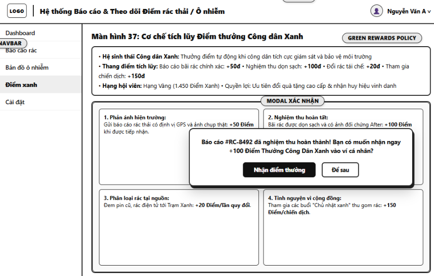  
*Hình 4.13: Giao diện phác thảo Cơ chế tích lũy Điểm thưởng Công dân Xanh*

*Bảng 4.13.1: Đặc tả thành phần giao diện chức năng 13 (Cơ chế tích lũy Điểm thưởng Công dân Xanh)*
| Mã Phần Tử UI | Tên Thành Phần Giao Diện | Kiểu Điều Khiển UI | Chức Năng & Tương Tác Nghiệp Vụ |
| :--- | :--- | :--- | :--- |
| `REW_TXT_POLICY` | Thẻ chính sách tích điểm | Information Card | Nêu rõ thang điểm chuẩn: +50đ báo cáo, +100đ nghiệm thu, +20đ tái chế, +150đ chiến dịch. |
| `REW_BADGE_TIER` | Huy hiệu hạng hội viên | Status Badge | Hiển thị thứ hạng hiện tại (Hạng Vàng: 1.450 Điểm Xanh) và quyền lợi đổi quà ưu tiên. |
| `REW_CARD_TASK_1` | Thẻ nhiệm vụ phản ánh | Action Card | Hướng dẫn gửi báo cáo rác định vị GPS kèm ảnh chụp thật để nhận +50 điểm. |
| `REW_CARD_TASK_2` | Thẻ nhiệm vụ nghiệm thu | Action Card | Hướng dẫn kiểm tra bãi rác dọn sạch kèm ảnh đối chứng After để nhận +100 điểm. |
| `REW_MODAL_CLAIM` | Hộp thoại xác nhận nhận thưởng | Dialog / Modal Popup | Thông báo sự cố #RC-8492 hoàn thành và hỏi công dân có muốn nhận thưởng vào ví. |
| `REW_BTN_CONFIRM_CLAIM` | Nút nhận điểm thưởng | Primary Button (Dark) | Kích hoạt giao dịch cộng điểm vào ví cá nhân và cập nhật số dư. |

- **Quy tắc kiểm tra và thông báo lỗi (Validation & Error Handling)**:

*Bảng 4.13.2: Quy tắc kiểm tra và thông báo lỗi chức năng 13 (Cơ chế tích lũy Điểm thưởng Công dân Xanh)*
| Trường Dữ Liệu / Tình Huống | Điều Kiện Ràng Buộc Kỹ Thuật | Mã Lỗi & Thông Điệp Phản Hồi Hiển Thị |
| :--- | :--- | :--- |
| Nhận thưởng trùng lặp | Một sự cố chỉ được kích hoạt nhận điểm 1 lần duy nhất | `REW_001`: Sự cố này đã được nhận điểm thưởng trước đó. |
| Sự cố chưa đủ điều kiện | Trạng thái sự cố chưa chuyển sang `RESOLVED` | `REW_002`: Báo cáo rác chưa hoàn tất nghiệm thu dọn dẹp sạch sẽ. |
| Tài khoản bị tạm khóa ví | Tài khoản đang trong thời gian xử lý vi phạm spam | `REW_003`: Tính năng tích điểm tạm thời bị đóng băng do vi phạm tiêu chuẩn cộng đồng. |

---

#### Chức năng 14: Xem số dư ví điểm và Lịch sử biến động điểm xanh (Points Balance & History)
- **Mục tiêu nghiệp vụ**: Cung cấp sổ cái điểm thưởng điện tử minh bạch, chi tiết cho mỗi công dân: Theo dõi số dư khả dụng (`1.450 Điểm Xanh`), điểm tích lũy trọn đời (`2.800 Điểm`), vị trí thi đua (`Top 5% công dân tích cực Quận 1`); tra cứu chi tiết từng dòng biến động điểm (cộng thưởng, trừ đổi quà) kèm thời gian thực; hỗ trợ xuất sao kê ví điểm định dạng PDF có chữ ký số điện tử để công dân sử dụng đối chiếu hoặc tham gia các chương trình tuyên dương khu phố.
- **Tác nhân (Actor)**: Công dân sở hữu tài khoản, Hệ thống báo cáo.
- **Tiền điều kiện**: Công dân đã đăng nhập vào cổng thông tin GreenSpot.
- **Hậu điều kiện**: Dữ liệu ví điểm và bảng lịch sử giao dịch được kết xuất đầy đủ, hỗ trợ bộ lọc và tải tệp sao kê PDF về thiết bị.
- **Quy trình xử lý nghiệp vụ (Workflow)**:
  1. Công dân truy cập vào mục "Điểm xanh" trên thanh menu bên trái, chọn tab "Ví Điểm & Lịch Sử Biến Động".
  2. Hệ thống truy vấn CSDL từ bảng `users` và `reward_transactions`, tải về số dư khả dụng (`1.450 ĐIỂM XANH`), hạng thành viên (`Hạng Vàng`), điểm trọn đời (`2.800 Điểm`).
  3. Bảng dữ liệu hiển thị danh sách các giao dịch được phân màu trực quan: Màu xanh lá cây cho giao dịch cộng (+100đ nghiệm thu bãi rác 128 Lê Lợi #RC-8492, +50đ báo cáo rác tự phát) và màu đỏ cho giao dịch trừ (-250đ đổi E-Voucher mua sắm Co.opmart #VCH-992).
  4. Công dân có thể chọn các bộ lọc nhanh: `[x] Tất cả giao dịch`, `[ ] Điểm cộng tích lũy`, `[ ] Điểm đã đổi quà`.
  5. Công dân bấm nút "Xuất sao kê ví điểm (PDF)" ở góc dưới bảng.
  6. Hệ thống hiển thị Modal xác nhận: *"Xác nhận trích xuất sao kê lịch sử biến động điểm thưởng Công Dân Xanh 30 ngày qua định dạng PDF?"* -> Công dân bấm "Tải về sao kê" để lưu tệp về máy tính.
- **Luồng thay thế (Alternative Flow)**:
  - Tra cứu biến động theo quý: Công dân chọn bộ lọc thời gian 3 tháng hoặc 6 tháng gần nhất để kiểm tra tổng điểm đóng góp cho địa bàn cư trú.
- **Luồng ngoại lệ (Exception Flow)**:
  - Tài khoản mới chưa có lịch sử biến động: Hệ thống hiển thị khung trạng thái rỗng (Empty State) kèm thông điệp gợi ý: "Bạn chưa có giao dịch điểm nào. Hãy tham gia gửi báo cáo rác để nhận điểm thưởng ngay!".
- **Mô tả thành phần giao diện (UI Specification)**:
  - Thẻ thông tin chủ tài khoản và số dư ví điểm lớn viền đen trang trọng; Nhãn phân hạng hội viên Hạng Vàng; Nhóm checkbox lọc loại giao dịch; Bảng lịch sử giao dịch chia theo mốc ngày giờ cụ thể; Nút "Xuất sao kê ví điểm (PDF)" và Modal xác nhận trích xuất.

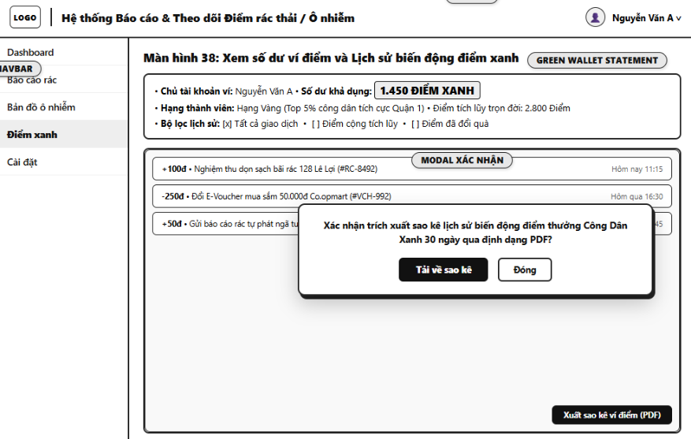  
*Hình 4.14: Giao diện phác thảo Xem số dư ví điểm và Lịch sử biến động điểm xanh*

*Bảng 4.14.1: Đặc tả thành phần giao diện chức năng 14 (Xem số dư ví điểm và Lịch sử biến động)*
| Mã Phần Tử UI | Tên Thành Phần Giao Diện | Kiểu Điều Khiển UI | Chức Năng & Tương Tác Nghiệp Vụ |
| :--- | :--- | :--- | :--- |
| `WAL_TXT_BALANCE` | Ô hiển thị số dư ví | Highlight Text Box | Thể hiện số dư khả dụng thực tế: 1.450 ĐIỂM XANH. |
| `WAL_BADGE_TIER` | Thông tin hạng thành viên | Badge Label | Nêu rõ phân hạng Hạng Vàng (Top 5% Quận 1) và tổng điểm tích lũy trọn đời 2.800đ. |
| `WAL_FLT_TYPE` | Bộ lọc loại giao dịch | Checkbox Group | Tùy chọn lọc: Tất cả giao dịch / Chỉ điểm cộng / Chỉ điểm trừ đã đổi quà. |
| `WAL_TBL_TRANSACTIONS` | Bảng nhật ký biến động điểm | Data List Table | Liệt kê chi tiết từng giao dịch kèm số điểm (+/-), mã sự cố, nội dung và thời gian. |
| `WAL_BTN_EXPORT_PDF` | Nút xuất sao kê PDF | Primary Button (Black) | Kích hoạt luồng xuất tệp sao kê điện tử có đóng dấu bảo chứng. |
| `WAL_MODAL_EXPORT` | Hộp thoại xác nhận tải sao kê | Dialog Modal | Xác nhận trích xuất báo cáo biến động điểm 30 ngày qua dạng tệp PDF. |

- **Quy tắc kiểm tra và thông báo lỗi (Validation & Error Handling)**:

*Bảng 4.14.2: Quy tắc kiểm tra và thông báo lỗi chức năng 14 (Xem số dư ví điểm và Lịch sử biến động)*
| Trường Dữ Liệu / Tình Huống | Điều Kiện Ràng Buộc Kỹ Thuật | Mã Lỗi & Thông Điệp Phản Hồi Hiển Thị |
| :--- | :--- | :--- |
| Trích xuất sao kê kỳ rỗng | Không có bất kỳ giao dịch nào trong khoảng thời gian chọn | `WAL_001`: Không có dữ liệu biến động điểm trong khoảng thời gian yêu cầu. |
| Lỗi tạo tệp PDF | Lỗi quá tải bộ xử lý render tài liệu máy chủ | `WAL_002`: Hệ thống tạm thời chưa thể tạo tệp PDF sao kê. Vui lòng thử lại sau giây lát. |
| Khoảng thời gian quá dài | Giới hạn trích xuất tối đa 12 tháng liên tục | `WAL_003`: Khoảng thời gian tra cứu sao kê tối đa là 1 năm cho mỗi lần xuất. |

---

#### Chức năng 15: Danh mục quà tặng xanh và Vật phẩm quy đổi (Eco-Reward Catalog)
- **Mục tiêu nghiệp vụ**: Thiết lập danh mục các vật phẩm quà tặng thân thiện môi trường và phiếu mua sắm xanh được tài trợ bởi các doanh nghiệp thực hành ESG và Quỹ Bảo vệ Môi trường: Bình giữ nhiệt Inox Eco 500ml (300 điểm), Voucher mua sắm Co.opmart 50.000đ (250 điểm), Chậu cây xanh Lưỡi Hổ để bàn thanh lọc không khí (200 điểm); phân loại quà theo nhóm vật dụng, voucher, cây xanh; hiển thị số lượng tồn kho trực tiếp và đối chiếu với số dư ví của công dân để hướng dẫn quy đổi thuận tiện.
- **Tác nhân (Actor)**: Công dân đô thị, Doanh nghiệp đối tác tài trợ quà tặng, Ban quản lý kho quà GreenSpot.
- **Tiền điều kiện**: Các món quà tặng được kích hoạt trạng thái khả dụng trong bảng `citizen_rewards`.
- **Hậu điều kiện**: Công dân duyệt xem danh mục, nắm bắt tồn kho và chọn được vật phẩm mong muốn để chuyển sang màn hình đổi điểm.
- **Quy trình xử lý nghiệp vụ (Workflow)**:
  1. Công dân bấm vào mục "Danh Mục Quà Tặng" trong phân hệ Điểm xanh (`Màn hình 39: Danh mục quà tặng xanh và Vật phẩm quy đổi`).
  2. Hệ thống tải dữ liệu các sản phẩm quà tặng từ bảng `citizen_rewards`, đối chiếu với số dư hiện tại của công dân và hiển thị thông điệp đầu trang: *"Số dư hiện tại của bạn: 1.450 Điểm Xanh (Đủ điều kiện đổi toàn bộ các phần quà trong danh mục)"*.
  3. Công dân sử dụng bộ lọc nhóm quà tặng: `[x] Vật dụng sống xanh` (Bình giữ nhiệt, Túi vải), `[ ] Voucher tiêu dùng xanh` (Phiếu mua sắm siêu thị), `[ ] Cây xanh đô thị` (Cây lọc không khí).
  4. Danh sách các phần quà hiển thị dạng lưới thẻ trực quan (Grid Cards):
     - *Bình giữ nhiệt Inox Eco 500ml*: Giảm thải chai nhựa • Còn 45 cái • `300 ĐIỂM`.
     - *Voucher 50.000đ Co.opmart*: Áp dụng toàn quốc • E-Voucher • `250 ĐIỂM`.
     - *Chậu cây Lưỡi Hổ để bàn*: Lọc không khí trong nhà • Còn 18 cây • `200 ĐIỂM`.
  5. Công dân bấm chọn vào một phần quà (VD: Bình giữ nhiệt Inox Eco).
  6. Hệ thống hiển thị Modal chi tiết quà tặng: *"Vật phẩm: Bình giữ nhiệt Inox Eco 500ml (300 Điểm Xanh). Bạn có muốn mở màn hình đổi vật phẩm này?"* kèm hai nút hành động: "Đổi quà ngay" và "Xem thêm".
- **Luồng thay thế (Alternative Flow)**:
  - Lọc theo tiêu chí "Quà đủ điểm đổi ngay": Tự động ẩn các món quà có giá trị điểm vượt quá số dư hiện có trong ví công dân để tiết kiệm thời gian tìm kiếm.
- **Luồng ngoại lệ (Exception Flow)**:
  - Vật phẩm đã hết số lượng tồn kho (Stock = 0): Hệ thống hiển thị nhãn màu xám "Tạm hết hàng", làm mờ thẻ sản phẩm và vô hiệu hóa nút đổi quà.
- **Mô tả thành phần giao diện (UI Specification)**:
  - Khung giới thiệu chính sách tài trợ 100% từ doanh nghiệp ESG; Hộp kiểm lọc nhóm quà tặng; Lưới thẻ quà tặng kèm số điểm viền đen đậm nổi bật; Modal chi tiết hiển thị ảnh, thông số tồn kho và nút chuyển hướng đổi quà ngay.

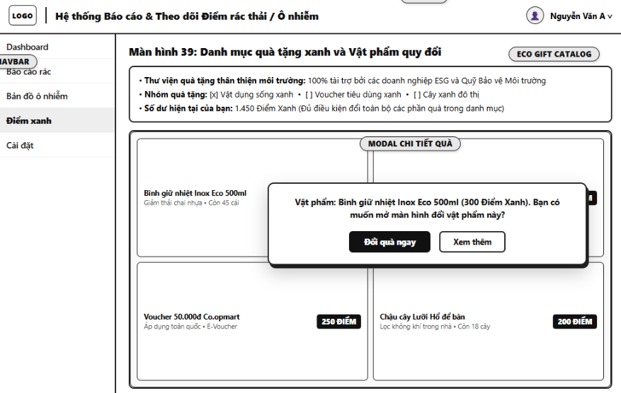  
*Hình 4.15: Giao diện phác thảo Danh mục quà tặng xanh và Vật phẩm quy đổi*

*Bảng 4.15.1: Đặc tả thành phần giao diện chức năng 15 (Danh mục quà tặng xanh và Vật phẩm quy đổi)*
| Mã Phần Tử UI | Tên Thành Phần Giao Diện | Kiểu Điều Khiển UI | Chức Năng & Tương Tác Nghiệp Vụ |
| :--- | :--- | :--- | :--- |
| `CAT_TXT_SPONSOR` | Khung thông tin tài trợ ESG | Info Banner | Giới thiệu nguồn gốc quà tặng tài trợ bởi doanh nghiệp xanh và Quỹ Môi trường. |
| `CAT_FLT_GROUP` | Bộ lọc nhóm quà tặng | Checkbox Filter | Phân loại: Vật dụng sống xanh, Voucher tiêu dùng xanh, Cây xanh đô thị. |
| `CAT_CARD_ITEM` | Thẻ sản phẩm quà tặng | Product Card | Hiển thị tên quà, ảnh minh họa, công dụng giảm rác thải và số lượng tồn kho. |
| `CAT_BADGE_POINTS` | Nhãn điểm quy đổi | Badge Number (Dark) | Thể hiện mức điểm cần để đổi (VD: 300 ĐIỂM, 250 ĐIỂM, 200 ĐIỂM). |
| `CAT_MODAL_DETAIL` | Hộp thoại chi tiết quà | Modal Dialog | Cửa sổ bật lên tóm tắt thông tin vật phẩm và hỏi xác nhận mở màn hình đổi thưởng. |
| `CAT_BTN_REDEEM_NOW` | Nút đổi quà ngay | Primary Button | Chuyển hướng người dùng sang màn hình thực hiện đổi điểm (Chức năng 16). |

- **Quy tắc kiểm tra và thông báo lỗi (Validation & Error Handling)**:

*Bảng 4.15.2: Quy tắc kiểm tra và thông báo lỗi chức năng 15 (Danh mục quà tặng xanh và Vật phẩm quy đổi)*
| Trường Dữ Liệu / Tình Huống | Điều Kiện Ràng Buộc Kỹ Thuật | Mã Lỗi & Thông Điệp Phản Hồi Hiển Thị |
| :--- | :--- | :--- |
| Vật phẩm đã hết tồn kho | Thuộc tính `stock_quantity <= 0` | `CAT_001`: Phần quà này hiện đã hết số lượng tồn kho. Vui lòng chọn quà tặng khác. |
| Số dư ví không đủ | Số dư ví công dân < điểm quy đổi của món quà | `CAT_002`: Số dư điểm xanh của bạn chưa đủ để đổi vật phẩm này. |
| Danh mục đang bảo trì | Kho quà đang trong kỳ kiểm kê định kỳ | `CAT_003`: Hệ thống kho quà đang tạm thời kiểm kê. Vui lòng quay lại sau. |

---

#### Chức năng 16: Thực hiện đổi điểm lấy quà tặng / Voucher (Reward Redemption Process)
- **Mục tiêu nghiệp vụ**: Thực thi quy trình giao dịch trừ điểm và cấp phát mã phiếu quà tặng điện tử (E-Voucher QR Code hoặc Phiếu nhận quà hiện vật) theo cơ chế giao dịch phân tán đảm bảo an toàn tuyệt đối (ACID Transaction): Tự động tính toán số dư trước và sau khi đổi, kiểm tra điều kiện tồn kho tức thời (Real-time Stock Locking), trừ chính xác điểm thưởng trong ví công dân, sinh mã định danh duy nhất (Unique Voucher Code) có thời hạn sử dụng 30 ngày và gửi xác nhận qua hòm thư ứng dụng kèm tin nhắn SMS.
- **Tác nhân (Actor)**: Công dân đổi thưởng, Hệ thống cổng thanh toán điểm thưởng GreenSpot.
- **Tiền điều kiện**: Công dân có số dư ví điểm >= giá trị quy đổi của phần quà; sản phẩm còn số lượng khả dụng trong kho.
- **Hậu điều kiện**: Số dư điểm trong ví bị trừ chính xác; bản ghi giao dịch đổi quà được tạo trong bảng `reward_transactions` với loại `REDEEMED`; mã phiếu quà tặng được kích hoạt trong ví quà cá nhân.
- **Quy trình xử lý nghiệp vụ (Workflow)**:
  1. Từ Modal chi tiết quà tặng, công dân bấm "Đổi quà ngay" (VD: Voucher mua sắm 50.000đ Siêu thị Co.opmart - Chi phí: 250 Điểm Xanh).
  2. Màn hình chuyển sang giao diện xác nhận thanh toán (`Màn hình 40: Thực hiện đổi điểm lấy quà tặng / Voucher`).
  3. Hệ thống hiển thị bảng cân đối tài chính chi tiết:
     - *Vật phẩm quy đổi: Voucher mua sắm 50.000đ Siêu thị Co.opmart (Áp dụng hàng tiêu dùng xanh)*.
     - *Chi phí điểm thưởng: 250 Điểm Xanh / voucher • Số lượng đổi: 1 voucher*.
     - *Số dư ví: Hiện có: 1.450 điểm → Sau khi đổi: 1.200 điểm (Đủ điều kiện thanh toán)*.
  4. Khung hướng dẫn thông tin nhận quà nêu rõ: Hình thức mã điện tử E-Voucher kèm mã QR quét tại quầy thu ngân siêu thị; Thời hạn sử dụng 30 ngày kể từ thời điểm đổi; Mã gửi trực tiếp vào mục "Quà tặng của tôi" và tin nhắn SMS.
  5. Công dân bấm nút nổi bật "XÁC NHẬN ĐỔI 250 ĐIỂM".
  6. Hệ thống bật hộp thoại Modal cảnh báo giao dịch: *"Xác nhận trừ 250 Điểm Xanh trong ví để nhận Voucher Co.opmart 50.000đ? Thao tác không thể hoàn tác."*.
  7. Công dân bấm nút "Xác nhận đổi". Hệ thống khóa tạm thời bản ghi sản phẩm (Row Lock), trừ 250 điểm, giảm tồn kho đi 1, sinh mã nhận quà ngẫu nhiên `ECO-8849-COOP` và hiển thị thông báo thành công.
- **Luồng thay thế (Alternative Flow)**:
  - Hủy bỏ giao dịch: Công dân bấm nút "Hủy giao dịch" hoặc "Hủy" trên Modal, hệ thống giải phóng giao dịch và quay về danh mục quà tặng mà không trừ bất kỳ điểm nào.
- **Luồng ngoại lệ (Exception Flow)**:
  - Tranh chấp tồn kho tại thời điểm xác nhận (Race condition): Nếu nhiều người cùng bấm đổi món quà cuối cùng tại cùng một thời điểm, hệ thống tự động hoàn nguyên (Rollback) giao dịch của người đến sau và hiển thị thông báo: "Sản phẩm vừa hết hàng trước khi giao dịch hoàn tất. Điểm của bạn vẫn được bảo toàn nguyên vẹn".
- **Mô tả thành phần giao diện (UI Specification)**:
  - Khung tóm tắt vật phẩm và biến động số dư trước/sau đổi; Khung quy chế sử dụng voucher; Thanh nút điều khiển hành động kép (Hủy giao dịch / Xác nhận đổi điểm); Hộp thoại Modal cảnh báo giao dịch bất biến.

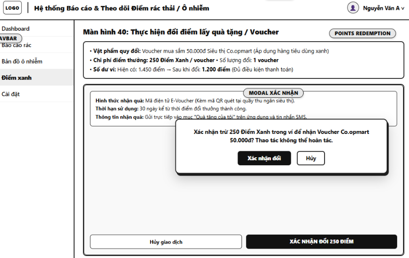  
*Hình 4.16: Giao diện phác thảo Thực hiện đổi điểm lấy quà tặng / Voucher*

*Bảng 4.16.1: Đặc tả thành phần giao diện chức năng 16 (Thực hiện đổi điểm lấy quà tặng / Voucher)*
| Mã Phần Tử UI | Tên Thành Phần Giao Diện | Kiểu Điều Khiển UI | Chức Năng & Tương Tác Nghiệp Vụ |
| :--- | :--- | :--- | :--- |
| `RDM_TXT_ITEM_INFO` | Khung thông tin vật phẩm quy đổi | Summary Card | Nêu rõ tên quà, giá trị tiền mặt (50.000đ) và định mức tiêu hao điểm (250đ). |
| `RDM_TXT_CALC_BALANCE` | Bảng tính đối soát số dư | Stat Box | So sánh số dư hiện có (1.450đ) và số dư sau khi trừ (1.200đ) minh bạch. |
| `RDM_BOX_POLICY` | Khung hướng dẫn sử dụng voucher | Alert Information Box | Hướng dẫn quét mã QR tại thu ngân, hạn dùng 30 ngày và kênh nhận SMS. |
| `RDM_BTN_CANCEL` | Nút hủy giao dịch | Outline Secondary Button | Hủy bỏ quy trình đổi điểm và quay về danh mục quà tặng. |
| `RDM_BTN_CONFIRM` | Nút xác nhận đổi điểm | Primary Action Button | Kích hoạt mở Modal cảnh báo giao dịch trừ điểm cuối cùng. |
| `RDM_MODAL_WARN` | Hộp thoại cảnh báo trừ điểm | Confirm Modal Dialog | Cảnh báo thao tác trừ 250 điểm là bất biến và yêu cầu người dùng xác thực. |

- **Quy tắc kiểm tra và thông báo lỗi (Validation & Error Handling)**:

*Bảng 4.16.2: Quy tắc kiểm tra và thông báo lỗi chức năng 16 (Thực hiện đổi điểm lấy quà tặng / Voucher)*
| Trường Dữ Liệu / Tình Huống | Điều Kiện Ràng Buộc Kỹ Thuật | Mã Lỗi & Thông Điệp Phản Hồi Hiển Thị |
| :--- | :--- | :--- |
| Số dư điểm không đủ trừ | `user_points < item_price` | `RDM_001`: Số dư điểm xanh của bạn không đủ để thực hiện giao dịch này. |
| Quà tặng vừa hết hàng | `stock_quantity == 0` tại thời điểm commit | `RDM_002`: Rất tiếc, sản phẩm đã hết hàng ngay trước khi bạn hoàn tất đổi quà. |
| Giới hạn đổi trong ngày | Vượt quá định mức tối đa 3 lần đổi quà / 24 giờ | `RDM_003`: Bạn đã đạt giới hạn tối đa 3 lượt đổi quà trong một ngày. Vui lòng quay lại ngày mai. |

---

#### Chức năng 17: Quản lý danh sách quà tặng cá nhân đã đổi (My Redeemed Rewards Tracking)
- **Mục tiêu nghiệp vụ**: Cung cấp ví quà tặng điện tử cá nhân (My Rewards Wallet) lưu trữ tập trung toàn bộ các voucher, mã giảm giá và phiếu nhận quà hiện vật công dân đã đổi thưởng thành công; cho phép hiển thị mã QR phóng to để quét trực tiếp tại quầy thu ngân siêu thị đối tác hoặc xuất trình tại bộ phận một cửa UBND Phường để nhận hiện vật; quản lý vòng đời trạng thái của từng món quà (Khả dụng, Đã sử dụng, Đã nhận hiện vật, Quá hạn).
- **Tác nhân (Actor)**: Công dân sở hữu voucher, Thu ngân siêu thị đối tác, Cán bộ tiếp nhận một cửa UBND Phường.
- **Tiền điều kiện**: Công dân đã thực hiện đổi thành công ít nhất một phần quà trong hệ thống.
- **Hậu điều kiện**: Hiển thị danh sách các món quà đã đổi; hiển thị mã QR bảo mật; cập nhật trạng thái sang "Đã sử dụng" sau khi thanh toán.
- **Quy trình xử lý nghiệp vụ (Workflow)**:
  1. Công dân mở phân hệ Điểm xanh -> chọn tab "Quà Tặng Của Tôi" (`Màn hình 41: Quản lý danh sách quà tặng cá nhân đã đổi`).
  2. Hệ thống tải danh sách các mã quà tặng thuộc quyền sở hữu của công dân kèm bộ lọc trạng thái: `[x] Khả dụng (Chưa dùng)`, `[ ] Đã sử dụng`, `[ ] Đã nhận hiện vật`.
  3. Danh sách thẻ quà hiển thị chi tiết:
     - Thẻ 1: *Voucher Co.opmart 50.000đ (#VCH-992)* • Hạn dùng: 15/10/2026 • Mã: `ECO-8849-COOP` kèm nút "MỞ MÃ QR".
     - Thẻ 2: *Bình giữ nhiệt Inox Eco 500ml (#GFT-042)* • Nơi nhận: Bộ phận Một cửa UBND Phường Bến Nghé kèm nút "Xem địa chỉ nhận".
  4. Khi đi siêu thị mua sắm, công dân bấm nút "MỞ MÃ QR" tại thẻ Voucher Co.opmart.
  5. Hệ thống hiển thị hộp thoại Modal phóng to mã QR kèm thông tin hướng dẫn: *"Mã Voucher ECO-8849-COOP: Quét mã QR tại quầy thanh toán Co.opmart để được giảm 50.000đ."*.
  6. Thu ngân quét mã bằng máy quét POS, hệ thống xác thực mã hợp lệ và tự động chuyển trạng thái của voucher sang `Đã sử dụng` (Used).
- **Luồng thay thế (Alternative Flow)**:
  - Nhận quà tặng hiện vật tại UBND Phường: Công dân mang mã phiếu nhận quà `#GFT-042` đến bộ phận một cửa UBND Phường xuất trình cho cán bộ kiểm tra; sau khi cán bộ bàn giao bình giữ nhiệt, hệ thống cập nhật trạng thái sang "Đã nhận hiện vật".
- **Luồng ngoại lệ (Exception Flow)**:
  - Voucher hết hạn sử dụng (Quá 30 ngày): Hệ thống tự động gắn nhãn màu xám "Đã hết hạn" và vô hiệu hóa nút mở mã QR.
- **Mô tả thành phần giao diện (UI Specification)**:
  - Thẻ hướng dẫn sử dụng mã voucher tại quầy thu ngân hoặc UBND Phường; Thanh lọc trạng thái 3 cấp độ; Danh sách thẻ quà tặng bo góc; Nút bật Modal mã QR phóng to; Nút bấm đánh dấu "Đã dùng voucher" và nút "Đóng".

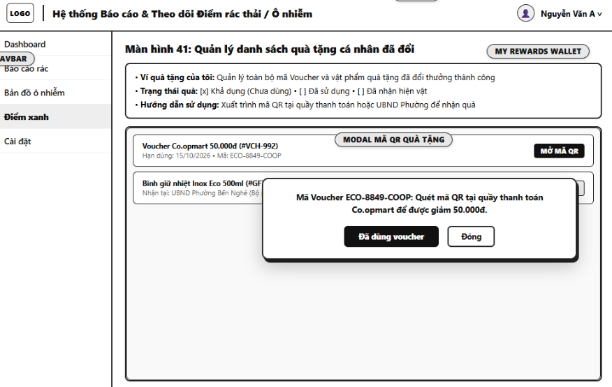  
*Hình 4.17: Giao diện phác thảo Quản lý danh sách quà tặng cá nhân đã đổi*

*Bảng 4.17.1: Đặc tả thành phần giao diện chức năng 17 (Quản lý danh sách quà tặng cá nhân đã đổi)*
| Mã Phần Tử UI | Tên Thành Phần Giao Diện | Kiểu Điều Khiển UI | Chức Năng & Tương Tác Nghiệp Vụ |
| :--- | :--- | :--- | :--- |
| `WAL_FLT_STATUS` | Bộ lọc trạng thái quà tặng | Radio / Checkbox Filter | Lọc theo: Khả dụng (Chưa dùng) / Đã sử dụng / Đã nhận hiện vật. |
| `WAL_CARD_REWARD` | Thẻ quà tặng cá nhân | Card Item Container | Hiển thị tên phần quà, mã định danh, hạn dùng và địa điểm nhận hiện vật. |
| `WAL_BTN_SHOW_QR` | Nút mở mã QR | Action Button (Dark) | Kích hoạt hiển thị cửa sổ Modal chứa mã QR thanh toán phóng to. |
| `WAL_MODAL_QR` | Hộp thoại hiển thị mã QR | Modal Dialog Popup | Cửa sổ hiển thị mã QR, mã chữ số và hướng dẫn cho nhân viên thu ngân. |
| `WAL_IMG_QR_CODE` | Hình ảnh mã QR bảo mật | QR Code Canvas | Mã hóa chuỗi token xác thực E-Voucher quét tại quầy tính tiền. |
| `WAL_BTN_MARK_USED` | Nút đánh dấu đã dùng | Secondary Button | Hỗ trợ người dùng tự đánh dấu voucher nếu đã sử dụng offline. |

- **Quy tắc kiểm tra và thông báo lỗi (Validation & Error Handling)**:

*Bảng 4.17.2: Quy tắc kiểm tra và thông báo lỗi chức năng 17 (Quản lý danh sách quà tặng cá nhân đã đổi)*
| Trường Dữ Liệu / Tình Huống | Điều Kiện Ràng Buộc Kỹ Thuật | Mã Lỗi & Thông Điệp Phản Hồi Hiển Thị |
| :--- | :--- | :--- |
| Voucher đã quá hạn dùng | Thời điểm quét `current_time > expiry_date` | `REW_VCH_001`: Phiếu quà tặng này đã hết hạn sử dụng vào ngày 15/10/2026. |
| Mã voucher đã quét trước đó | Trạng thái bản ghi `status == 'USED'` | `REW_VCH_002`: Mã voucher này đã được sử dụng trước đó tại siêu thị. |
| Sai đơn vị đổi quà hiện vật | Xuất trình mã nhận hiện vật sai địa bàn Phường | `REW_VCH_003`: Vui lòng xuất trình mã nhận quà đúng tại UBND Phường được chỉ định. |

---

#### Chức năng 18: Bảng xếp hạng vinh danh Top Công dân Xanh (Green Citizen Leaderboard)
- **Mục tiêu nghiệp vụ**: Lan tỏa tinh thần trách nhiệm xã hội và xây dựng phong trào thi đua sống xanh trong cộng đồng cư dân đô thị: Vinh danh Top 10 cá nhân tiêu biểu có đóng góp xuất sắc nhất cho môi trường trong tháng/quý; hiển thị thứ hạng cá nhân (`Hạng 14 toàn Quận - 1.450 Điểm`), chỉ rõ khoảng cách điểm số để lọt vào Top 10 nhận kỷ niệm chương; tích hợp cơ chế đăng ký xét tặng Kỷ niệm chương và Bằng khen Công Dân Xanh Tiêu Biểu của UBND Quận/Thành phố.
- **Tác nhân (Actor)**: Toàn thể công dân, Hội đồng Thi đua - Khen thưởng địa phương, Ban chỉ đạo công tác môi trường.
- **Tiền điều kiện**: Dữ liệu điểm tích lũy của các công dân trong kỳ báo cáo được tổng hợp đầy đủ trong cơ sở dữ liệu.
- **Hậu điều kiện**: Hiển thị bảng xếp hạng danh dự minh bạch; công dân có thứ hạng cao được ghi nhận vào danh sách xét tặng kỷ niệm chương.
- **Quy trình xử lý nghiệp vụ (Workflow)**:
  1. Công dân bấm vào mục "Bảng Xếp Hạng" trên thanh điều hướng (`Màn hình 42: Bảng xếp hạng vinh danh Top Công dân Xanh`).
  2. Đầu trang hiển thị thông số thành tích cá nhân: *Bảng xếp hạng Tháng 09/2026: Vinh danh các cá nhân có đóng góp xuất sắc nhất cho môi trường đô thị • Vị trí của bạn: Hạng 14 toàn Quận (1.450 Điểm) • Còn 150 điểm để lọt vào Top 10 nhận Kỷ niệm chương*.
  3. Người dùng chọn phạm vi xem bảng: `[x] Toàn Quận 1`, `[ ] Cấp Phường`, `[ ] Toàn Thành phố`.
  4. Hệ thống hiển thị danh sách vinh danh có huy hiệu danh dự trang trọng:
     - Hạng 1: Nguyễn Văn An (Phường Bến Thành) - `4.850 ĐIỂM` (Huy hiệu Vàng).
     - Hạng 2: Trần Thị Mai (Phường Tân Định) - `4.200 ĐIỂM` (Huy hiệu Bạc).
     - Hạng 3: Lê Hoàng Nam (Phường Cầu Kho) - `3.950 ĐIỂM` (Huy hiệu Đồng).
     - Dòng cố định đánh dấu vị trí cá nhân: `Hạng 14: BẠN (Nguyễn Văn A) - 1.450 ĐIỂM`.
  5. Hệ thống hiển thị hộp thoại Modal vinh danh: *"Chúc mừng bạn đã đạt Hạng 14! Bạn có muốn đăng ký nhận Kỷ niệm chương Công Dân Xanh Tiêu Biểu quý này?"*.
  6. Công dân bấm nút "Đăng ký vinh danh", hệ thống lưu hồ sơ ứng cử khen thưởng gửi tới Ban Thi đua Quận xét duyệt tại Ngày hội Môi trường Đô thị.
- **Luồng thay thế (Alternative Flow)**:
  - Xem bảng xếp hạng theo tổ chức / trường học: Cho phép chuyển đổi xem bảng thi đua giữa các trường THPT hoặc các khu phố văn hóa trên địa bàn.
- **Luồng ngoại lệ (Exception Flow)**:
  - Tài khoản có dấu hiệu gian lận điểm số: Tự động loại khỏi danh sách xếp hạng và chuyển sang trạng thái chờ thanh tra kiểm toán.
- **Mô tả thành phần giao diện (UI Specification)**:
  - Khung tóm tắt thứ hạng cá nhân; Bộ lọc phạm vi địa bàn; Bảng danh sách vinh danh có icon cúp huy chương Vàng/Bạc/Đồng; Dòng highlight vị trí bản thân; Hộp thoại Modal đăng ký xét tặng kỷ niệm chương.

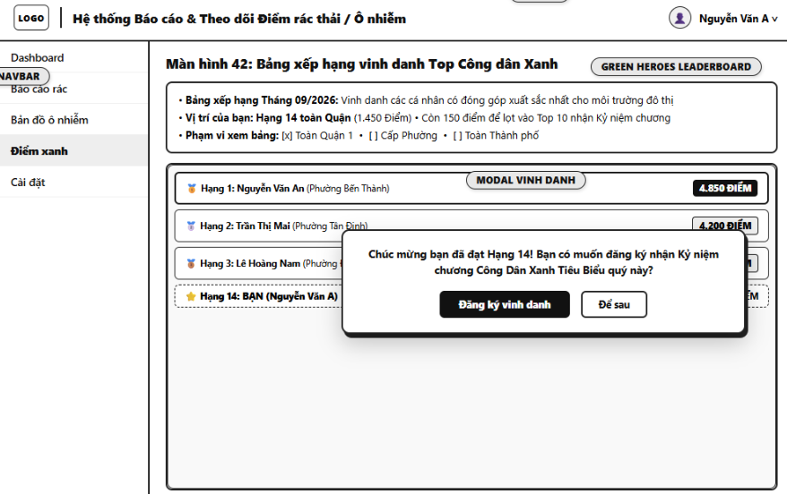  
*Hình 4.18: Giao diện phác thảo Bảng xếp hạng vinh danh Top Công dân Xanh*

*Bảng 4.18.1: Đặc tả thành phần giao diện chức năng 18 (Bảng xếp hạng vinh danh Top Công dân Xanh)*
| Mã Phần Tử UI | Tên Thành Phần Giao Diện | Kiểu Điều Khiển UI | Chức Năng & Tương Tác Nghiệp Vụ |
| :--- | :--- | :--- | :--- |
| `LDB_TXT_MY_RANK` | Khung thành tích cá nhân | Stat Header Box | Hiển thị thứ hạng (Hạng 14), số điểm (1.450đ) và khoảng cách vào Top 10 (150đ). |
| `LDB_FLT_SCOPE` | Bộ lọc phạm vi xếp hạng | Segmented Checkbox | Lựa chọn phạm vi tra cứu: Toàn Quận 1 / Cấp Phường / Toàn Thành phố. |
| `LDB_ROW_TOP_1` | Dòng vinh danh Hạng 1 | Leaderboard Row | Nêu rõ tên công dân tiêu biểu, địa bàn cư trú và số điểm cống hiến cao nhất. |
| `LDB_ROW_MY_USER` | Dòng đánh dấu vị trí của tôi | Highlighted Row (Star) | Đánh dấu vị trí người dùng đang đăng nhập với ngôi sao vàng viền đứt đoạn. |
| `LDB_MODAL_HONOR` | Hộp thoại đăng ký vinh danh | Dialog Modal | Mời công dân có thành tích xuất sắc nộp hồ sơ nhận Kỷ niệm chương. |
| `LDB_BTN_SUBMIT_HONOR` | Nút đăng ký vinh danh | Primary Action Button | Gửi nguyện vọng khen thưởng tới Hội đồng Thi đua Quận. |

- **Quy tắc kiểm tra và thông báo lỗi (Validation & Error Handling)**:

*Bảng 4.18.2: Quy tắc kiểm tra và thông báo lỗi chức năng 18 (Bảng xếp hạng vinh danh Top Công dân Xanh)*
| Trường Dữ Liệu / Tình Huống | Điều Kiện Ràng Buộc Kỹ Thuật | Mã Lỗi & Thông Điệp Phản Hồi Hiển Thị |
| :--- | :--- | :--- |
| Chưa chốt bảng xếp hạng kỳ | Chu kỳ tháng đang diễn ra, số liệu tính toán realtime | `LDB_001`: Bảng xếp hạng đang cập nhật dữ liệu thi đua tháng 09/2026. |
| Điểm số chưa đạt Top xét tặng | Thứ hạng nằm ngoài phạm vi được khen thưởng | `LDB_002`: Bạn cần đạt tối thiểu Top 20 của Quận để đủ điều kiện xét tặng kỷ niệm chương. |
| Tài khoản đang bị khiếu nại | Bị tố cáo gian lận điểm hoặc spam tin báo | `LDB_003`: Điểm thi đua của tài khoản đang trong quá trình rà soát đối chiếu. |

---

#### Chức năng 19: Xem danh sách các Chiến dịch ra quân bảo vệ môi trường (Environmental Campaign Showcase)
- **Mục tiêu nghiệp vụ**: Tổng hợp, truyền thông và quảng bá các phong trào ra quân dọn dẹp vệ sinh môi trường do Đoàn Thanh niên, UBND Phường và các hội đoàn thể phát động: Giới thiệu chiến dịch trọng điểm tuần (VD: "Chủ nhật xanh - Làm sạch tuyến kênh Nhiêu Lộc - Thị Nghè"); công khai quyền lợi của tình nguyện viên (cấp áo thun, găng tay, kẹp gắp rác và cộng `+150 Điểm Xanh`); thể hiện tỷ lệ đăng ký theo thời gian thực (VD: `78/100 tình nguyện viên`) để kêu gọi công dân cùng hưởng ứng.
- **Tác nhân (Actor)**: Công dân, Tình nguyện viên, Ban tổ chức chiến dịch môi trường.
- **Tiền điều kiện**: Các chiến dịch đã được cơ quan chức năng thẩm định và xuất bản trên cổng thông tin.
- **Hậu điều kiện**: Công dân nắm bắt đầy đủ thông tin về thời gian, địa điểm, chỉ tiêu và mở form đăng ký tham gia.
- **Quy trình xử lý nghiệp vụ (Workflow)**:
  1. Công dân truy cập trang "Chiến Dịch Xanh" trên cổng thông tin (`Màn hình 43: Xem danh sách các Chiến dịch ra quân dọn rác`).
  2. Đầu trang thể hiện khung giới thiệu phong trào nổi bật: *"Chiến dịch nổi bật tuần này: Chủ nhật xanh - Làm sạch tuyến kênh Nhiêu Lộc - Thị Nghè • Quyền lợi tham gia: Cấp áo tình nguyện, găng tay, kẹp gắp rác chuyên dụng & cộng +150 Điểm Xanh"*.
  3. Danh sách các chiến dịch hiển thị dạng thẻ ngang trực quan:
     - Chiến dịch 1: *"Chủ nhật xanh lần thứ 152"* • Thời gian: 07:00 - 10:30 Chủ nhật (20/09) • Địa điểm: Bờ kè Kênh Nhiêu Lộc • `ĐÃ ĐĂNG KÝ: 78/100`.
     - Chiến dịch 2: *"Chung tay làm sạch điểm đen rác thải Phường..."* • Thời gian: 08:00 Thứ 7 (26/09) • Phối hợp Đoàn phường.
  4. Công dân bấm chọn vào chiến dịch *"Chủ nhật xanh lần thứ 152"*.
  5. Hệ thống hiển thị Modal chi tiết chiến dịch: *"Chiến dịch Chủ nhật xanh (20/09) tại Kênh Nhiêu Lộc. Bạn có muốn đăng ký tham gia đội tình nguyện viên?"*.
  6. Công dân bấm nút "Đăng ký ngay" để chuyển tiếp sang màn hình điền thông tin đăng ký tình nguyện viên (Chức năng 20).
- **Luồng thay thế (Alternative Flow)**:
  - Lọc chiến dịch theo địa bàn Phường: Công dân chọn khu vực gần nơi mình sinh sống để ưu tiên tham gia các hoạt động vệ sinh tại tổ dân phố mình.
- **Luồng ngoại lệ (Exception Flow)**:
  - Chiến dịch đã kín chỗ (Đăng ký đủ 100/100): Hệ thống hiển thị nhãn "Đã đủ số lượng" và tự động khóa tiếp nhận thêm đơn đăng ký mới.
- **Mô tả thành phần giao diện (UI Specification)**:
  - Khung banner chiến dịch nổi bật; Khung thẻ quyền lợi tham gia; Lưới danh sách các chiến dịch kèm thanh tiến độ số lượng đăng ký (Progress Bar); Khung Modal xác nhận mở đơn đăng ký.

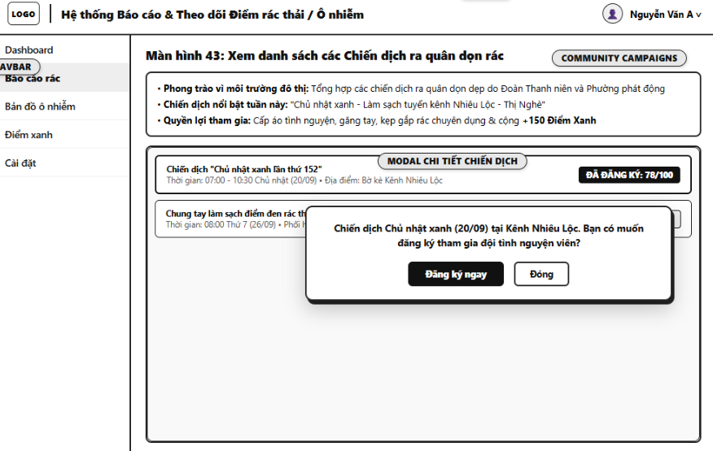  
*Hình 4.19: Giao diện phác thảo Xem danh sách các Chiến dịch ra quân dọn rác*

*Bảng 4.19.1: Đặc tả thành phần giao diện chức năng 19 (Xem danh sách các Chiến dịch ra quân dọn rác)*
| Mã Phần Tử UI | Tên Thành Phần Giao Diện | Kiểu Điều Khiển UI | Chức Năng & Tương Tác Nghiệp Vụ |
| :--- | :--- | :--- | :--- |
| `CMP_BANNER_FEATURED` | Khung phong trào môi trường | Highlight Card | Giới thiệu chiến dịch trọng điểm tuần này tại Kênh Nhiêu Lộc - Thị Nghè. |
| `CMP_TXT_PERKS` | Thẻ quyền lợi tình nguyện viên | Info Text List | Nêu rõ việc cấp phát áo, găng tay, dụng cụ và mức cộng +150 Điểm Xanh. |
| `CMP_CARD_CAMPAIGN` | Thẻ thông tin chiến dịch | Campaign Card | Hiển thị tên chiến dịch, mốc thời gian diễn ra và địa điểm tập kết lực lượng. |
| `CMP_TXT_REGISTER_COUNT` | Thước đo số lượng đã đăng ký | Status Badge (Dark) | Thể hiện số lượng tình nguyện viên đã đăng ký thực tế (VD: ĐÃ ĐĂNG KÝ: 78/100). |
| `CMP_MODAL_DETAIL` | Hộp thoại xác nhận đăng ký | Modal Dialog Popup | Cửa sổ tóm tắt chiến dịch và hỏi công dân có muốn gia nhập đội tình nguyện. |
| `CMP_BTN_JOIN_NOW` | Nút đăng ký ngay | Primary Button | Chuyển hướng người dùng sang biểu mẫu đăng ký tham gia (Chức năng 20). |

- **Quy tắc kiểm tra và thông báo lỗi (Validation & Error Handling)**:

*Bảng 4.19.2: Quy tắc kiểm tra và thông báo lỗi chức năng 19 (Xem danh sách các Chiến dịch ra quân dọn rác)*
| Trường Dữ Liệu / Tình Huống | Điều Kiện Ràng Buộc Kỹ Thuật | Mã Lỗi & Thông Điệp Phản Hồi Hiển Thị |
| :--- | :--- | :--- |
| Chiến dịch đã đủ quân số | `registered_count >= max_slots` | `CMP_001`: Chiến dịch này đã đủ số lượng tình nguyện viên đăng ký (100/100). |
| Quá hạn đăng ký trước ngày ra quân | `current_time > deadline_register` | `CMP_002`: Thời hạn đăng ký tham gia chiến dịch này đã kết thúc trước 24 giờ. |
| Chiến dịch tạm hoãn do mưa bão | Ban tổ chức cập nhật trạng thái `POSTPONED` | `CMP_003`: Chiến dịch tạm hoãn do điều kiện thời tiết xấu. Lịch mới sẽ được thông báo sau. |

---

#### Chức năng 20: Đăng ký tham gia chiến dịch tình nguyện xanh (Join Campaign Registration)
- **Mục tiêu nghiệp vụ**: Tự động hóa quy trình tiếp nhận và quản lý danh sách tình nguyện viên tham gia chiến dịch môi trường thực tế: Tự động điền thông tin cá nhân từ tài khoản người dùng, cho phép chọn ca làm việc (Ca trọn vẹn hưởng +150đ, Ca tăng cường hưởng +75đ), chọn nhóm nhiệm vụ phù hợp năng lực (Thu gom rác ven kênh, Phân loại rác đóng bao, Hậu cần tiếp nước), xác nhận cam kết an toàn lao động và cấp Mã thẻ tình nguyện viên (Volunteer Pass) điện tử phục vụ điểm danh quét mã QR tại hiện trường.
- **Tác nhân (Actor)**: Công dân tình nguyện viên, Ban tổ chức thực địa, Hệ thống quản lý tình nguyện.
- **Tiền điều kiện**: Chiến dịch còn chỉ tiêu tiếp nhận (Slot > 0); công dân đã xác thực số điện thoại trên hệ thống.
- **Hậu điều kiện**: Ghi nhận bản ghi tham gia vào bảng `campaign_participants`; tăng số lượng đăng ký lên 1; cấp mã định danh tình nguyện viên `VOL-2026-152-079` và gửi xác nhận qua SMS.
- **Quy trình xử lý nghiệp vụ (Workflow)**:
  1. Từ Chức năng 19, công dân mở biểu mẫu `Màn hình 44: Đăng ký tham gia chiến dịch tình nguyện xanh`.
  2. Hệ thống tự động trích xuất thông tin: Họ tên (`Nguyễn Văn A`) và Số điện thoại liên hệ (`0908 123 456`).
  3. Công dân chọn ca tham gia: "Ca trọn vẹn: 07:00 - 10:30 (Được cộng trọn +150đ)".
  4. Công dân chọn phân công nhóm công việc: "Thu gom rác ven bờ kè & vớt rác rãnh nước".
  5. Công dân tích chọn hộp kiểm: *"Tôi cam kết tuân thủ quy định an toàn lao động và hướng dẫn của Ban tổ chức"*.
  6. Công dân bấm nút "GỬI ĐĂNG KÝ THAM GIA".
  7. Hệ thống hiển thị hộp thoại Modal xác nhận: *"Xác nhận đăng ký tham gia Chiến dịch Chủ nhật xanh lần thứ 152? Mã xác nhận VOL-2026-152-079 sẽ được gửi qua tin nhắn SMS."*.
  8. Công dân bấm "Xác nhận đăng ký", hệ thống lưu bản ghi vào bảng `campaign_participants`, sinh mã QR điểm danh gửi vào mục quà tặng cá nhân và gửi tin nhắn SMS xác nhận lịch hẹn.
- **Luồng thay thế (Alternative Flow)**:
  - Hủy đăng ký trước 24 giờ: Nếu có việc đột xuất không thể tham gia, công dân vào danh sách chiến dịch bấm "Hủy đăng ký" để hệ thống nhường suất cho người khác và không bị trừ điểm uy tín.
- **Luồng ngoại lệ (Exception Flow)**:
  - Đăng ký trùng lặp: Nếu tài khoản đã đăng ký chiến dịch này rồi, hệ thống chặn lại và hiển thị thông báo "Bạn đã đăng ký tham gia chiến dịch này trước đó".
- **Mô tả thành phần giao diện (UI Specification)**:
  - Khung tóm tắt chiến dịch đã chọn; Biểu mẫu nhập liệu gồm ô thông tin cá nhân, dropdown chọn ca, dropdown chọn tổ nhiệm vụ; Checkbox cam kết an toàn; Nút gửi đăng ký; Modal xác nhận cấp mã thẻ tình nguyện viên.

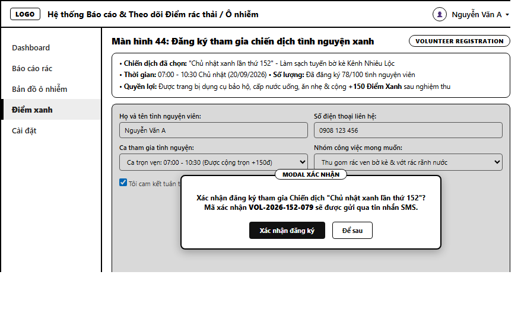  
*Hình 4.20: Giao diện phác thảo Đăng ký tham gia chiến dịch tình nguyện xanh*

*Bảng 4.20.1: Đặc tả thành phần giao diện chức năng 20 (Đăng ký tham gia chiến dịch tình nguyện xanh)*
| Mã Phần Tử UI | Tên Thành Phần Giao Diện | Kiểu Điều Khiển UI | Chức Năng & Tương Tác Nghiệp Vụ |
| :--- | :--- | :--- | :--- |
| `REG_TXT_FULLNAME` | Ô họ và tên tình nguyện viên | Text Input (Readonly) | Tự động điền họ tên từ thông tin tài khoản đăng nhập (Nguyễn Văn A). |
| `REG_TXT_PHONE` | Ô số điện thoại liên hệ | Text Input | Nhập số điện thoại để Ban tổ chức gửi tin nhắn điều phối và nhắc lịch. |
| `REG_DDL_SHIFT` | Bộ chọn ca tham gia | Dropdown Select | Chọn: Ca trọn vẹn (07h-10h30: +150đ) hoặc Ca tăng cường (08h30-10h30: +75đ). |
| `REG_DDL_ROLE` | Bộ chọn nhóm công việc | Dropdown Select | Lựa chọn: Thu gom bờ kè, Phân loại đóng bao, hoặc Hậu cần tiếp nước. |
| `REG_CHK_SAFETY` | Hộp kiểm cam kết an toàn | Checkbox | Bắt buộc tích chọn cam kết tuân thủ quy định an toàn lao động. |
| `REG_BTN_SUBMIT` | Nút gửi đăng ký tham gia | Primary Action Button | Kích hoạt mở Modal xác nhận và cấp mã thẻ tình nguyện viên. |
| `REG_MODAL_CONFIRM` | Hộp thoại xác nhận đăng ký | Confirmation Modal | Xác nhận tham gia chiến dịch và thông báo cấp mã định danh VOL-2026-152-079. |

- **Quy tắc kiểm tra và thông báo lỗi (Validation & Error Handling)**:

*Bảng 4.20.2: Quy tắc kiểm tra và thông báo lỗi chức năng 20 (Đăng ký tham gia chiến dịch tình nguyện xanh)*
| Trường Dữ Liệu / Tình Huống | Điều Kiện Ràng Buộc Kỹ Thuật | Mã Lỗi & Thông Điệp Phản Hồi Hiển Thị |
| :--- | :--- | :--- |
| Trùng lặp người đăng ký | `user_id` đã tồn tại trong `campaign_participants` | `VOL_001`: Bạn đã đăng ký tham gia chiến dịch môi trường này rồi. |
| Số điện thoại sai định dạng | Không khớp định dạng SĐT Việt Nam 10 chữ số | `VOL_002`: Vui lòng nhập số điện thoại hợp lệ để Ban tổ chức liên hệ. |
| Chưa xác nhận cam kết an toàn | Checkbox `is_agreed_safety == False` | `VOL_003`: Bạn bắt buộc phải đồng ý với cam kết an toàn lao động trước khi đăng ký. |
| Chiến dịch vừa kín chỗ | Đạt ngưỡng 100 tình nguyện viên ngay khi bấm | `VOL_004`: Rất tiếc, chỉ tiêu tình nguyện viên của chiến dịch vừa được lấp đầy. |

---

#### Chức năng 21: Bình luận và Thảo luận dưới bài phản ánh sự cố (Incident Public Comments)
- **Mục tiêu nghiệp vụ**: Xây dựng kênh trao đổi thông tin minh bạch, công khai hai chiều giữa các bên liên quan ngay dưới hồ sơ sự cố ô nhiễm môi trường: Cho phép công dân người báo cáo, người dân sống tại khu vực, tổ trưởng dân phố và cán bộ đội vệ sinh môi trường cùng thảo luận, cập nhật tình hình thực tế hiện trường (VD: xe rác đã đến, khối lượng rác phát sinh, hoàn tất xịt rửa); tích hợp bộ lọc ngôn từ văn minh tự động (Profanity Filter) kiểm duyệt 24/7 ngăn chặn các bình luận tiêu cực, chửi bới hoặc công kích cá nhân.
- **Tác nhân (Actor)**: Công dân người báo tin, Cư dân khu dân cư, Tổ trưởng dân phố, Cán bộ tiếp nhận xử lý.
- **Tiền điều kiện**: Sự cố ô nhiễm đã được công bố trên cổng thông tin; người dùng đã đăng nhập tài khoản.
- **Hậu điều kiện**: Bình luận được ghi nhận vào bảng `incident_comments`; đẩy thông báo thời gian thực tới những người đang theo dõi hồ sơ.
- **Quy trình xử lý nghiệp vụ (Workflow)**:
  1. Người dùng mở trang chi tiết một điểm sự cố rác thải (VD: Hồ sơ `#RC-8492` tại đường Lê Văn Việt - `Màn hình 45: Bình luận và Thảo luận dưới bài phản ánh sự cố`).
  2. Khung thảo luận hiển thị các ý kiến theo trình tự thời gian:
     - Trần Văn Hùng (Tổ trưởng dân phố 4 - 08:30): *"Bãi rác này bốc mùi quá hôi, cảm ơn bà con đã kịp thời phản ánh lên GreenSpot."*
     - Cán bộ VSMT Đội 2 (09:15): *"Xe chuyên dụng đang trên đường di chuyển tới hiện trường, dự kiến 10h dọn sạch."*
     - Nguyễn Văn A (Công dân báo cáo - 10:10): *"Đội công nhân vừa gom xong đống rác lớn, hiện đang xịt rửa vỉa hè rất sạch sẽ!"*
  3. Người dùng nhập ý kiến thảo luận vào ô văn bản ở cuối trang.
  4. Bấm nút "Gửi bình luận", hệ thống kiểm tra qua bộ lọc từ khóa nhạy cảm.
  5. Hệ thống hiển thị hộp thoại Modal xác nhận: *"Xác nhận đăng bình luận công khai dưới sự cố #RC-8492? Bình luận của bạn sẽ hiển thị minh bạch cho toàn bộ cộng đồng khu dân cư."*.
  6. Người dùng bấm "Đăng bình luận", hệ thống lưu bản ghi và hiển thị ngay trên luồng thảo luận.
- **Luồng thay thế (Alternative Flow)**:
  - Báo cáo bình luận xấu: Nếu phát hiện bình luận có dấu hiệu xúc phạm hoặc quảng cáo rác, người dùng bấm nút cờ báo cáo vi phạm để quản trị viên kiểm duyệt gỡ bỏ.
- **Luồng ngoại lệ (Exception Flow)**:
  - Vi phạm từ ngữ thô tục: Bộ lọc phát hiện từ ngữ xúc phạm danh dự, hệ thống từ chối đăng, bôi đỏ đoạn vi phạm và cảnh báo: "Bình luận chứa từ ngữ không phù hợp chuẩn mực cộng đồng".
- **Mô tả thành phần giao diện (UI Specification)**:
  - Khung tóm tắt mã hồ sơ và đơn vị xử lý; Luồng danh sách bình luận phân biệt rõ nhãn chức danh (Tổ trưởng / Cán bộ / Công dân); Ô nhập nội dung văn bản kèm nút Gửi bình luận; Modal xác nhận tính công khai của bình luận.

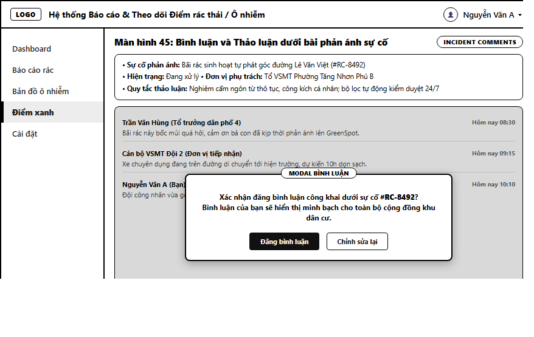  
*Hình 4.21: Giao diện phác thảo Bình luận và Thảo luận dưới bài phản ánh sự cố*

*Bảng 4.21.1: Đặc tả thành phần giao diện chức năng 21 (Bình luận và Thảo luận dưới bài phản ánh sự cố)*
| Mã Phần Tử UI | Tên Thành Phần Giao Diện | Kiểu Điều Khiển UI | Chức Năng & Tương Tác Nghiệp Vụ |
| :--- | :--- | :--- | :--- |
| `CMT_LIST_CONTAINER` | Khung hiển thị luồng bình luận | Scrollable Comment List | Chứa danh sách các ý kiến thảo luận được sắp xếp theo mốc thời gian tăng dần. |
| `CMT_ITEM_HEADER` | Thanh tiêu đề bình luận | User Tag & Timestamp | Hiển thị tên người bình luận, vai trò (Cán bộ / Tổ trưởng) và thời điểm đăng. |
| `CMT_ITEM_BODY` | Nội dung văn bản bình luận | Text Block | Nội dung đóng góp ý kiến, cập nhật hiện trạng dọn dẹp hoặc lời cảm ơn. |
| `CMT_TXT_INPUT` | Ô nhập bình luận mới | Text Input Box | Cho phép người dân gõ nội dung phản hồi hoặc cập nhật tình hình thực tế. |
| `CMT_BTN_SEND` | Nút gửi bình luận | Action Button (Primary) | Gửi dữ liệu qua bộ kiểm duyệt ngôn từ trước khi hiển thị lên hệ thống. |
| `CMT_MODAL_CONFIRM` | Hộp thoại xác nhận đăng tin | Confirmation Modal | Xác nhận tính công khai minh bạch của ý kiến trước cộng đồng khu dân cư. |

- **Quy tắc kiểm tra và thông báo lỗi (Validation & Error Handling)**:

*Bảng 4.21.2: Quy tắc kiểm tra và thông báo lỗi chức năng 21 (Bình luận và Thảo luận dưới bài phản ánh sự cố)*
| Trường Dữ Liệu / Tình Huống | Điều Kiện Ràng Buộc Kỹ Thuật | Mã Lỗi & Thông Điệp Phản Hồi Hiển Thị |
| :--- | :--- | :--- |
| Bình luận để trống hoặc quá ngắn | Độ dài nội dung `< 5` ký tự | `CMT_001`: Vui lòng nhập nội dung bình luận tối thiểu từ 5 ký tự trở lên. |
| Vi phạm bộ lọc từ khóa nhạy cảm | Chứa từ ngữ thô tục trong từ điển cấm | `CMT_002`: Bình luận chứa từ ngữ không phù hợp chuẩn mực văn hóa ứng xử đô thị. |
| Tần suất gửi bình luận quá nhanh | Gửi liên tiếp 2 bình luận cách nhau `< 10` giây | `CMT_003`: Bạn thao tác quá nhanh. Vui lòng chờ 10 giây trước khi gửi bình luận tiếp theo. |

---

#### Chức năng 22: Đánh giá mức độ hài lòng (1–5 sao) sau khi dọn sạch (Post-Resolution Satisfaction Rating)
- **Mục tiêu nghiệp vụ**: Đo lường định lượng mức độ hài lòng của nhân dân (CSAT - Citizen Satisfaction Score) đối với chất lượng phục vụ công ích của các Đội Vệ sinh môi trường đô thị: Khi một điểm rác được công bố đã dọn sạch, hệ thống kích hoạt màn hình cho phép công dân trực tiếp chấm điểm từ 1 đến 5 sao, đánh giá tiêu chí tuân thủ thời gian cam kết SLA (Service Level Agreement), chất lượng dọn sạch hiện trường và để lại lời nhận xét góp ý; kết quả đánh giá được chuyển thẳng vào hệ thống KPI thi đua khen thưởng cán bộ hàng tháng.
- **Tác nhân (Actor)**: Công dân người tạo báo cáo, Cư dân sinh sống tại khu vực, Phòng Quản lý Đô thị Quận.
- **Tiền điều kiện**: Sự cố đã được Đội VSMT hoàn tất dọn dẹp, có ảnh chụp đối chứng After và chuyển trạng thái `RESOLVED`.
- **Hậu điều kiện**: Bản ghi đánh giá được ghi nhận vào bảng `incident_ratings` và bảng `incidents`; tính toán điểm số CSAT trung bình của đơn vị thu gom; tự động cộng `+10 Điểm Xanh` tri ân công dân đã phản hồi chất lượng.
- **Quy trình xử lý nghiệp vụ (Workflow)**:
  1. Khi sự cố `#RC-8492` được hoàn thành, hệ thống gửi thông báo mời người báo cáo đánh giá chất lượng nghiệm thu.
  2. Công dân mở màn hình `Màn hình 46: Đánh giá mức độ hài lòng (1–5 sao) sau khi dọn sạch`.
  3. Thẻ thông tin công bố kết quả thực hiện: *Đơn vị thực hiện: Tổ VSMT Số 2 • Thời gian dọn: 2h45p (Đúng hạn cam kết SLA) • Ý kiến của công dân: Giúp nâng cao chất lượng phục vụ và đánh giá thi đua cán bộ hàng tháng*.
  4. Công dân chọn mức độ hài lòng trên thanh sao: Chọn `5/5 SAO (RẤT HÀI LÒNG - HIỆN TRƯỜNG SẠCH ĐẸP & NHANH CHÓNG)`.
  5. Công dân nhập lời góp ý: *"Đội công nhân dọn rất sạch, có rắc vôi khử mùi hôi. Rất cảm ơn các anh chị!"*.
  6. Bấm nút "Gửi đánh giá", hệ thống hiển thị hộp thoại Modal xác nhận: *"Xác nhận gửi đánh giá 5 sao cho Đội VSMT Số 2? Điểm đánh giá sẽ được ghi nhận vào hệ thống KPI chất lượng phục vụ."*.
  7. Công dân bấm "Gửi đánh giá", hệ thống ghi nhận điểm số vào CSDL và tự động thưởng thêm `+10 Điểm Xanh` vào ví cá nhân.
- **Luồng thay thế (Alternative Flow)**:
  - Đánh giá chưa hài lòng (1-2 sao): Nếu công dân chấm 1 hoặc 2 sao kèm phản ánh dọn dẹp còn sót rác bẩn, hệ thống tự động sinh lệnh phúc tra hiện trường gửi Tổ trưởng giám sát xuống kiểm tra đột xuất trong 2 giờ.
- **Luồng ngoại lệ (Exception Flow)**:
  - Đánh giá lặp lại: Mỗi tài khoản công dân chỉ được gửi đánh giá chất lượng 1 lần duy nhất cho một hồ sơ sự cố.
- **Mô tả thành phần giao diện (UI Specification)**:
  - Khung công bố chỉ số SLA của đơn vị thu gom rác; Thanh chọn sao tương tác (1-5 sao); Khung nhập ý kiến góp ý chi tiết; Hộp thoại Modal xác nhận điểm số KPI; Nút Gửi đánh giá và nút Hủy.

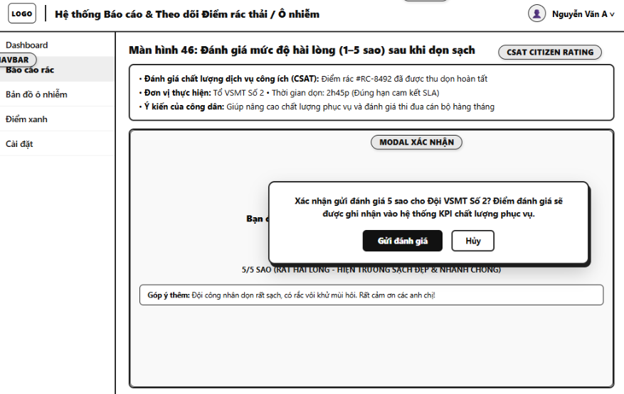  
*Hình 4.22: Giao diện phác thảo Đánh giá mức độ hài lòng (1–5 sao) sau khi dọn sạch*

*Bảng 4.22.1: Đặc tả thành phần giao diện chức năng 22 (Đánh giá mức độ hài lòng sau khi dọn sạch)*
| Mã Phần Tử UI | Tên Thành Phần Giao Diện | Kiểu Điều Khiển UI | Chức Năng & Tương Tác Nghiệp Vụ |
| :--- | :--- | :--- | :--- |
| `RAT_TXT_UNIT_SLA` | Khung công bố thông tin xử lý | Service Info Card | Nêu rõ đơn vị thực hiện (Tổ VSMT Số 2) và thời gian dọn thực tế (2h45p). |
| `RAT_STAR_SELECTOR` | Thanh chọn số sao hài lòng | Star Rating Control | Cho phép chọn từ 1 sao đến 5 sao kèm nhãn giải thích mức độ hài lòng. |
| `RAT_TXT_FEEDBACK` | Khung nhập góp ý bổ sung | Text Area Input | Nơi công dân viết nhận xét khen ngợi hoặc phản ánh những điểm chưa sạch. |
| `RAT_BTN_SUBMIT` | Nút gửi đánh giá | Action Button (Dark) | Kích hoạt mở Modal xác nhận ghi nhận số sao đánh giá. |
| `RAT_MODAL_CONFIRM` | Hộp thoại xác nhận đánh giá | Modal Confirmation | Thông báo xác nhận điểm số sẽ được ghi vào KPI chất lượng của đơn vị thu gom. |
| `RAT_BTN_CONFIRM_SEND` | Nút xác nhận gửi | Primary Button | Hoàn tất lưu đánh giá và kích hoạt cộng +10 Điểm Xanh tri ân người dân. |

- **Quy tắc kiểm tra và thông báo lỗi (Validation & Error Handling)**:

*Bảng 4.22.2: Quy tắc kiểm tra và thông báo lỗi chức năng 22 (Đánh giá mức độ hài lòng sau khi dọn sạch)*
| Trường Dữ Liệu / Tình Huống | Điều Kiện Ràng Buộc Kỹ Thuật | Mã Lỗi & Thông Điệp Phản Hồi Hiển Thị |
| :--- | :--- | :--- |
| Chưa chọn số sao | Giá trị `rating_stars == 0` | `RAT_001`: Vui lòng chọn số sao đánh giá mức độ hài lòng (từ 1 đến 5 sao). |
| Đánh giá kém nhưng thiếu lý do | Đánh giá `<= 2` sao nhưng để trống ô góp ý | `RAT_002`: Vui lòng nhập lý do chưa hài lòng để đơn vị vệ sinh khắc phục xử lý lại. |
| Đánh giá trùng lặp sự cố | Tài khoản đã chấm điểm cho sự cố này rồi | `RAT_003`: Bạn đã hoàn thành đánh giá cho hồ sơ sự cố này trước đó. |

---

#### Chức năng 23: Gửi ý kiến đóng góp và Sáng kiến bảo vệ môi trường (Green Initiative Submission Form)
- **Mục tiêu nghiệp vụ**: Thiết lập Hòm thư điện tử Tiếp nhận Sáng kiến & Hiến kế vì Môi trường Xanh: Tạo diễn đàn cho người dân, nhà khoa học trẻ và học sinh sinh viên gửi các đề án, giải pháp công nghệ hoặc mô hình tự quản khu dân cư trực tiếp tới Hội đồng Khoa học & Đổi mới sáng tạo - Sở Tài nguyên và Môi trường TP.HCM; hỗ trợ kết nối các sáng kiến xuất sắc với Quỹ Đổi mới Môi trường để nhận gói kinh phí hỗ trợ triển khai thí điểm thực tế tại địa phương.
- **Tác nhân (Actor)**: Công dân hiến kế, Hội đồng Thẩm định Khoa học Sở TN&MT.
- **Tiền điều kiện**: Công dân đã đăng nhập tài khoản GreenSpot và có đề xuất giải pháp môi trường.
- **Hậu điều kiện**: Hồ sơ sáng kiến được lưu vào bảng `green_initiatives`; cấp mã tra cứu hồ sơ (VD: `INIT-2026-HCM-042`) và cam kết gửi văn bản phản hồi thẩm định trong vòng 7 ngày làm việc.
- **Quy trình xử lý nghiệp vụ (Workflow)**:
  1. Công dân truy cập trang "Hiến Kế Sống Xanh" trên cổng thông tin (`Màn hình 47: Gửi ý kiến đóng góp và Sáng kiến bảo vệ môi trường`).
  2. Đầu trang thể hiện cơ quan thụ lý và chính sách khen thưởng: *Hội đồng Khoa học & Đổi mới sáng tạo - Sở Tài nguyên và Môi trường TP.HCM • Giải thưởng sáng kiến: Vinh danh và nhận gói hỗ trợ triển khai thực tế từ Quỹ Đổi mới Môi trường*.
  3. Công dân điền thông tin vào biểu mẫu:
     - Tiêu đề sáng kiến: *"Lắp đặt thùng rác phân loại cảm ứng thông minh năng lượng mặt trời tại Công viên 23/9"*.
     - Tóm tắt giải pháp: Trình bày cơ chế tự động nén rác khi đầy, cảm biến thông báo về trung tâm điều hành, tính toán chi phí và hiệu quả giảm rác vương vãi.
     - Đính kèm tệp bản vẽ thiết kế hoặc tài liệu thuyết minh (nếu có).
  4. Công dân bấm nút "GỬI SÁNG KIẾN TỚI SỞ TN&MT".
  5. Hệ thống hiển thị Modal xác nhận: *"Xác nhận nộp sáng kiến môi trường tới Sở TN&MT? Bạn sẽ nhận được thư phản hồi thẩm định trong vòng 7 ngày làm việc."*.
  6. Công dân bấm "Nộp sáng kiến", hệ thống sinh mã hồ sơ `INIT-2026-HCM-042`, lưu vào CSDL và gửi thư biên nhận tự động tới hộp thư điện tử của công dân.
- **Luồng thay thế (Alternative Flow)**:
  - Lưu bản nháp (Save Draft): Cho phép công dân lưu lại nội dung sáng kiến để tiếp tục bổ sung hình ảnh, tài liệu kỹ thuật trước khi nộp chính thức.
- **Luồng ngoại lệ (Exception Flow)**:
  - Nội dung hiến kế quá sơ sài: Bắt buộc phần tóm tắt giải pháp phải có độ dài từ 50 ký tự trở lên để đảm bảo tính nghiêm túc của đề xuất.
- **Mô tả thành phần giao diện (UI Specification)**:
  - Khung giới thiệu cơ quan thụ lý và quỹ đổi mới sáng kiến; Ô nhập tiêu đề sáng kiến; Khung soạn thảo văn bản mô tả giải pháp rộng rãi; Nút tải tệp đính kèm; Nút gửi sáng kiến tới Sở; Modal xác nhận cam kết phản hồi 7 ngày.

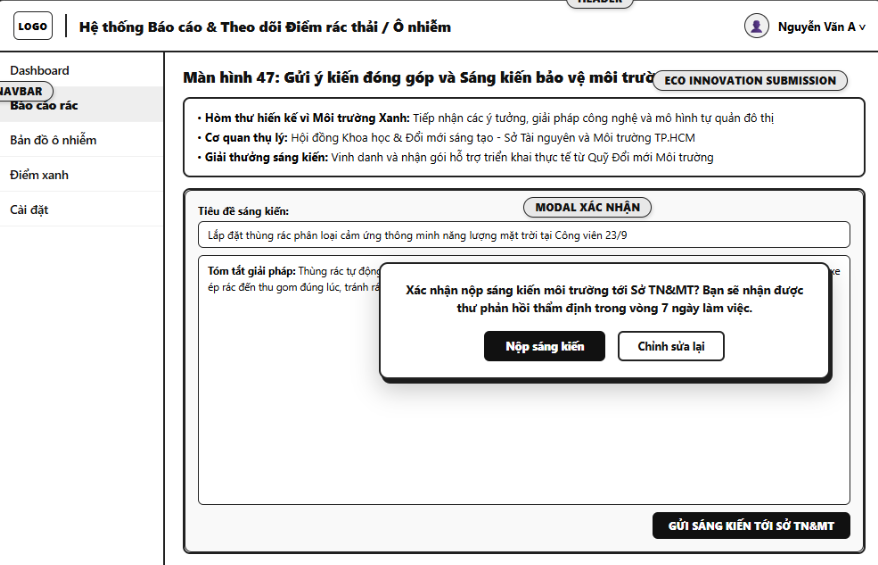  
*Hình 4.23: Giao diện phác thảo Gửi ý kiến đóng góp và Sáng kiến bảo vệ môi trường*

*Bảng 4.23.1: Đặc tả thành phần giao diện chức năng 23 (Gửi ý kiến đóng góp và Sáng kiến bảo vệ môi trường)*
| Mã Phần Tử UI | Tên Thành Phần Giao Diện | Kiểu Điều Khiển UI | Chức Năng & Tương Tác Nghiệp Vụ |
| :--- | :--- | :--- | :--- |
| `INI_TXT_BOARD` | Khung thông tin cơ quan thụ lý | Header Card | Nêu rõ Hội đồng tiếp nhận thuộc Sở TN&MT và chính sách tài trợ thí điểm. |
| `INI_TXT_TITLE` | Ô tiêu đề sáng kiến | Text Input | Nhập tên giải pháp sáng kiến (VD: Lắp đặt thùng rác thông minh năng lượng mặt trời). |
| `INI_TXT_DESCRIPTION` | Khung tóm tắt giải pháp | Text Area (Large) | Mô tả chi tiết nguyên lý, vật liệu, chi phí và hiệu quả môi trường mang lại. |
| `INI_FILE_ATTACHMENT` | Nút đính kèm tài liệu | File Uploader | Cho phép đính kèm tệp PDF bản vẽ hoặc bảng thuyết minh tính khả thi. |
| `INI_BTN_SUBMIT` | Nút gửi sáng kiến tới Sở | Action Button (Dark) | Kích hoạt mở Modal xác nhận nộp đề án tới cơ quan quản lý. |
| `INI_MODAL_CONFIRM` | Hộp thoại xác nhận nộp sáng kiến | Confirmation Modal | Cam kết gửi thư phản hồi kết quả thẩm định của Hội đồng trong 7 ngày làm việc. |

- **Quy tắc kiểm tra và thông báo lỗi (Validation & Error Handling)**:

*Bảng 4.23.2: Quy tắc kiểm tra và thông báo lỗi chức năng 23 (Gửi ý kiến đóng góp và Sáng kiến bảo vệ môi trường)*
| Trường Dữ Liệu / Tình Huống | Điều Kiện Ràng Buộc Kỹ Thuật | Mã Lỗi & Thông Điệp Phản Hồi Hiển Thị |
| :--- | :--- | :--- |
| Tiêu đề sáng kiến quá ngắn | Độ dài tiêu đề `< 10` ký tự | `INI_001`: Tiêu đề sáng kiến phải có độ dài từ 10 ký tự trở lên. |
| Mô tả giải pháp quá sơ lược | Độ dài tóm tắt `< 50` ký tự | `INI_002`: Vui lòng mô tả tóm tắt giải pháp tối thiểu 50 ký tự để Hội đồng thẩm định. |
| Tệp đính kèm vượt kích thước | Kích thước file đính kèm `> 20MB` | `INI_003`: Dung lượng tệp đính kèm tối đa là 20MB (chấp nhận định dạng PDF, DOCX, ZIP). |

---

#### Chức năng 24: Cẩm nang hướng dẫn phân loại rác tại nguồn và Sống xanh (Waste Sorting & Green Living Handbook)
- **Mục tiêu nghiệp vụ**: Triển khai cuốn Sổ tay điện tử hướng dẫn phân loại chất thải rắn sinh hoạt tại nguồn theo đúng quy định của Luật Bảo vệ Môi trường 2020: Hướng dẫn trực quan cách phân chia 3 dòng rác chính (Rác tái chế - Túi Trắng, Rác thực phẩm - Túi Xanh, Rác còn lại & Nguy hại - Túi Xám); tích hợp bài trắc nghiệm tương tác nhanh 1 phút (5 câu hỏi thực tế) để kiểm tra kiến thức công dân và tự động cộng ngay `+50 Điểm Thưởng` cùng Huy hiệu "Công Dân Xanh Hiểu Biết" vào tài khoản.
- **Tác nhân (Actor)**: Toàn thể nhân dân, Học sinh sinh viên, Tình nguyện viên môi trường.
- **Tiền điều kiện**: Người dùng truy cập cổng thông tin GreenSpot.
- **Hậu điều kiện**: Nắm vững phương pháp phân loại rác; hoàn thành trắc nghiệm và nhận điểm thưởng vào ví cá nhân.
- **Quy trình xử lý nghiệp vụ (Workflow)**:
  1. Người dùng mở mục "Cẩm Nang Sống Xanh" (`Màn hình 48: Cẩm nang hướng dẫn phân loại rác và Sống xanh`).
  2. Màn hình chia thành 3 cột đồ họa chuyên đề trực quan:
     - Cột 1: `1. RÁC TÁI CHẾ (Túi Trắng)`: Chai nhựa, giấy vụn, vỏ lon nhôm, hộp kim loại -> Bán ve chai hoặc gửi Trạm Xanh.
     - Cột 2: `2. RÁC THỰC PHẨM (Túi Xanh)`: Thức ăn thừa, rau củ hư hỏng, bã trà/cà phê, lá cây -> Ủ phân hữu cơ vi sinh.
     - Cột 3: `3. RÁC CÒN LẠI & HẠI (Túi Xám)`: Bịch nilon dơ, tã lót, pin cũ, bóng đèn hư, chai lọ hóa chất nguy hại -> Đưa vào luồng xử lý chuyên biệt.
  3. Hệ thống hiển thị hộp thoại Modal trắc nghiệm xanh: *"Bạn có muốn tham gia bài Trắc nghiệm nhanh 1 phút về phân loại rác để tích lũy ngay +50 Điểm Thưởng?"*.
  4. Người dùng bấm nút "Bắt đầu trắc nghiệm", trả lời 5 câu hỏi tình huống sinh hoạt hàng ngày (VD: Vỏ hộp sữa giấy sau khi uống xong cần xử lý thế nào trước khi bỏ thùng rác?).
  5. Sau khi trả lời đúng từ 4/5 câu trở lên, hệ thống tự động cộng `+50 Điểm Xanh` vào ví cá nhân và cấp Huy hiệu điện tử trên trang cá nhân.
- **Luồng thay thế (Alternative Flow)**:
  - Tải cẩm nang Infographic PDF in ấn: Cho phép người dân tải tệp poster đồ họa độ phân giải cao về in ra dán tại góc bếp gia đình hoặc bảng tin khu phố.
- **Luồng ngoại lệ (Exception Flow)**:
  - Chưa đạt điểm yêu cầu trong bài trắc nghiệm: Hệ thống hiển thị bảng giải thích đáp án đúng của từng câu hỏi và cho phép người dùng ôn tập làm lại sau 24 giờ.
- **Mô tả thành phần giao diện (UI Specification)**:
  - Bố cục 3 cột trực quan tương ứng 3 nhóm rác thải sinh hoạt; Icon đồ họa đại diện từng loại rác; Khung Modal trắc nghiệm kiến thức nhận điểm thưởng; Nút Bắt đầu trắc nghiệm và nút Để sau.

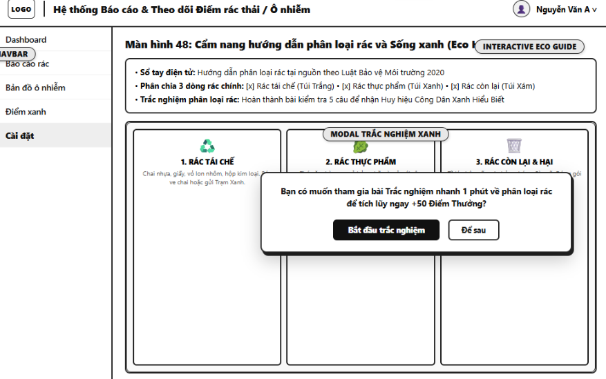  
*Hình 4.24: Giao diện phác thảo Cẩm nang hướng dẫn phân loại rác và Sống xanh*

*Bảng 4.24.1: Đặc tả thành phần giao diện chức năng 24 (Cẩm nang hướng dẫn phân loại rác và Sống xanh)*
| Mã Phần Tử UI | Tên Thành Phần Giao Diện | Kiểu Điều Khiển UI | Chức Năng & Tương Tác Nghiệp Vụ |
| :--- | :--- | :--- | :--- |
| `GUI_COL_RECYCLE` | Cột phân loại rác tái chế | Guide Column (White) | Hướng dẫn cách gom chai nhựa, giấy, kim loại và địa điểm gửi Trạm Xanh. |
| `GUI_COL_ORGANIC` | Cột phân loại rác thực phẩm | Guide Column (Green) | Hướng dẫn phân loại thức ăn thừa, rau củ để chế biến phân hữu cơ. |
| `GUI_COL_HAZARDOUS` | Cột rác nguy hại & còn lại | Guide Column (Gray) | Cảnh báo quy trình gom pin cũ, đồ điện tử để bảo vệ môi trường đất và nước. |
| `GUI_MODAL_QUIZ` | Hộp thoại trắc nghiệm nhận thưởng | Dialog Modal Popup | Mời người dân tham gia bài kiểm tra nhanh 5 câu hỏi để nhận +50 Điểm Xanh. |
| `GUI_BTN_START_QUIZ` | Nút bắt đầu trắc nghiệm | Primary Action Button | Kích hoạt bộ câu hỏi trắc nghiệm tương tác kiến thức phân loại rác. |
| `GUI_BTN_POSTPONE` | Nút để sau | Secondary Outline Button | Đóng hộp thoại trắc nghiệm để tiếp tục đọc tài liệu cẩm nang. |

- **Quy tắc kiểm tra và thông báo lỗi (Validation & Error Handling)**:

*Bảng 4.24.2: Quy tắc kiểm tra và thông báo lỗi chức năng 24 (Cẩm nang hướng dẫn phân loại rác và Sống xanh)*
| Trường Dữ Liệu / Tình Huống | Điều Kiện Ràng Buộc Kỹ Thuật | Mã Lỗi & Thông Điệp Phản Hồi Hiển Thị |
| :--- | :--- | :--- |
| Đã nhận thưởng trắc nghiệm tuần này | Mỗi tài khoản chỉ được cộng điểm trắc nghiệm 1 lần/tuần | `GUI_001`: Bạn đã hoàn thành bài trắc nghiệm và nhận +50 điểm trong tuần này rồi. |
| Bỏ dở bài trắc nghiệm | Thoát giữa chừng khi chưa trả lời hết 5 câu | `GUI_002`: Bài trắc nghiệm chưa hoàn thành. Điểm thưởng chỉ được cấp khi trả lời đủ 5 câu. |
| Lỗi tải tệp Infographic | Kết nối mạng gián đoạn khi tải tài liệu | `GUI_003`: Không thể tải tệp cẩm nang Infographic. Vui lòng kiểm tra lại kết nối mạng. |

---

### 2. Phân hệ Bùi Nguyễn Minh Quân (25 → 36)
> **Định hướng cốt lõi**: Cổng thông tin Cảnh báo Ô nhiễm Môi trường & Giám sát Công khai Dành cho Người Dân (không xử lý sự cố hiện trường).  
> **Cấu trúc đặc tả**: Mỗi chức năng được chuẩn hóa toàn diện gồm: Mục tiêu nghiệp vụ, Tác nhân (Actor), Tiền điều kiện, Hậu điều kiện, Quy trình xử lý (Workflow 5 bước), Luồng thay thế, Luồng ngoại lệ, Bảng đặc tả thành phần giao diện (UI Table) và Bảng quy tắc kiểm tra, xử lý lỗi (Validation Table).

---

#### Chức năng 25: Cổng xác thực tập trung đa nền tảng và Quản lý phiên JWT an toàn (Multi-provider Auth & Secure JWT Session Lifecycle)
- **Mục tiêu nghiệp vụ**: Cung cấp cơ chế xác thực người dùng tập trung đa nền tảng (Web Portal, Mobile Web); áp dụng chuẩn bảo mật cặp Token (Access Token thời hạn 15 phút, Refresh Token thời hạn 7 ngày); lưu trữ Refresh Token trong HttpOnly Cookie để phòng chống tấn công XSS; tích hợp cơ chế Rate Limiting chống tấn công dò quét mật khẩu (Brute-Force Attack).
- **Tác nhân (Actor)**: Quản trị viên hệ thống (Admin), Cán bộ biên tập cảnh báo, Công dân đô thị.
- **Tiền điều kiện**: Người dùng truy cập vào cổng thông tin qua trình duyệt; máy chủ Auth Service hoạt động bình thường.
- **Hậu điều kiện**: Hệ thống cấp phát cặp mã phiên JWT hợp lệ; người dùng đăng nhập thành công vào đúng không gian quyền hạn; ghi nhận phiên làm việc vào bảng `user_sessions`.
- **Quy trình xử lý nghiệp vụ (Workflow)**:
  1. Người dùng mở trang Đăng nhập trên Cổng thông tin GreenSpot, nhập tên tài khoản (Email/Số điện thoại) và mật khẩu cá nhân.
  2. Máy chủ tiếp nhận thông tin, kiểm tra mã băm mật khẩu trong CSDL bằng thuật toán Argon2id / bcrypt.
  3. Nếu thông tin hợp lệ, máy chủ sinh Access Token (chứa định danh người dùng và danh sách quyền) cùng Refresh Token (kèm định danh phiên JTI duy nhất).
  4. Hệ thống ghi nhận phiên hoạt động mới vào bảng `user_sessions`, đồng thời thiết lập Refresh Token vào `HttpOnly, Secure, SameSite=Strict Cookie`.
  5. Trình duyệt tự động đính kèm Access Token trong tiêu đề HTTP `Authorization: Bearer <token>` để thực thi các yêu cầu nghiệp vụ tiếp theo.
- **Luồng thay thế (Alternative Flow)**:
  - Đăng nhập nhanh qua tài khoản Google (OAuth 2.0): Người dùng chọn "Đăng nhập với Google", hệ thống chuyển hướng sang Google Identity Service, sau khi Google xác nhận sẽ tự động liên kết hoặc tạo tài khoản công dân tương ứng trong hệ thống.
- **Luồng ngoại lệ (Exception Flow)**:
  - Nhập sai mật khẩu liên tiếp quá 5 lần: Hệ thống kích hoạt cơ chế khóa tạm thời tài khoản trong 15 phút để chống tấn công Brute-Force; hiển thị thông báo thời gian mở khóa còn lại và gửi cảnh báo về email đã đăng ký.
- **Mô tả thành phần giao diện (UI Specification)**:
  - Giao diện đăng nhập hiện đại, trực quan, hỗ trợ chế độ Responsive trên điện thoại và máy tính. Có form đăng nhập, form đăng ký, nút chuyển đổi phương thức đăng nhập và bảng theo dõi các phiên làm việc đang hoạt động (Active Sessions).

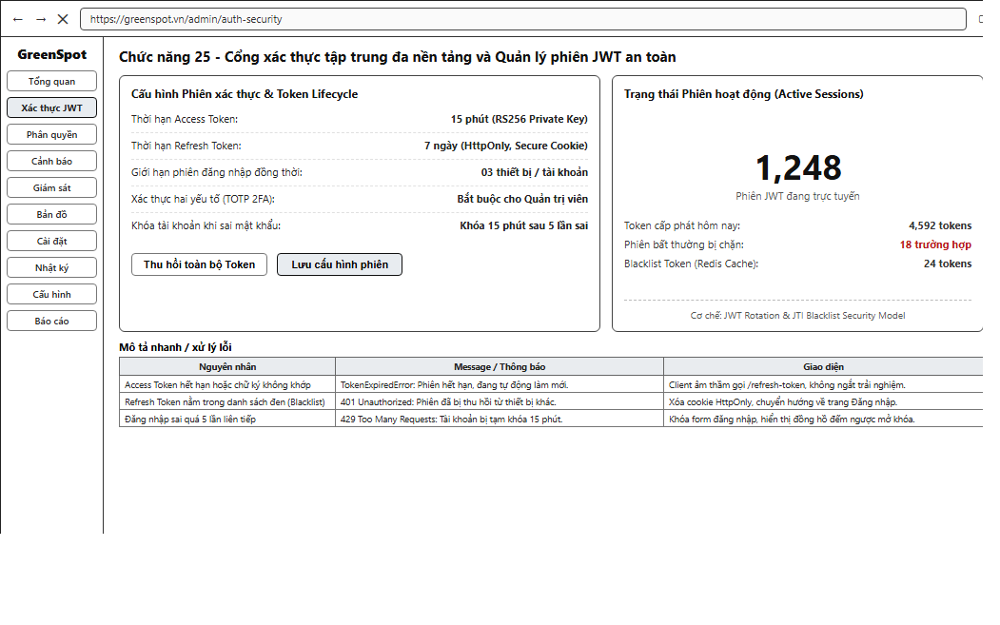
*Hình 4.25: Giao diện phác thảo Cổng xác thực tập trung đa nền tảng và Quản lý phiên JWT an toàn*

*Bảng 4.25.1: Đặc tả thành phần giao diện chức năng 25 (Cổng xác thực tập trung và Quản lý phiên JWT)*
| Mã Phần Tử UI | Tên Thành Phần Giao Diện | Kiểu Điều Khiển UI | Chức Năng & Tương Tác Nghiệp Vụ |
| :--- | :--- | :--- | :--- |
| `AUTH_TXT_USERNAME` | Ô nhập tài khoản | Text Input | Nhập địa chỉ Email hoặc Số điện thoại đăng nhập. |
| `AUTH_TXT_PASSWORD` | Ô nhập mật khẩu | Password Input (Show/Hide) | Nhập mật khẩu tài khoản, có icon con mắt bật/tắt hiển thị ký tự. |
| `AUTH_BTN_SUBMIT` | Nút đăng nhập | Primary Button | Gửi thông tin chứng thực lên máy chủ Auth API. |
| `AUTH_BTN_GOOGLE` | Nút đăng nhập Google | Social Button (OAuth2) | Kích hoạt luồng đăng nhập nhanh bằng Google Account. |
| `AUTH_TBL_SESSIONS` | Bảng phiên làm việc | Data Table (Grid) | Liệt kê danh sách các thiết bị/trình duyệt đang đăng nhập kèm IP và nút "Đăng xuất khỏi thiết bị này". |

- **Quy tắc kiểm tra và thông báo lỗi (Validation & Error Handling)**:

*Bảng 4.25.2: Quy tắc kiểm tra và thông báo lỗi chức năng 25 (Cổng xác thực tập trung và Quản lý phiên JWT)*
| Trường Dữ Liệu / Tình Huống | Điều Kiện Ràng Buộc Kỹ Thuật | Mã Lỗi & Thông Điệp Phản Hồi Hiển Thị |
| :--- | :--- | :--- |
| Email / SĐT để trống | Bắt buộc nhập, không được để trống | `AUTH_001`: Vui lòng nhập địa chỉ email hoặc số điện thoại. |
| Mật khẩu không hợp lệ | Mật khẩu tối thiểu 8 ký tự, gồm chữ và số | `AUTH_002`: Mật khẩu phải có độ dài từ 8 ký tự trở lên. |
| Tài khoản hoặc mật khẩu sai | Không khớp bản ghi băm trong CSDL | `AUTH_003`: Email/SĐT hoặc mật khẩu không chính xác. Vui lòng thử lại. |
| Tài khoản bị tạm khóa | Sai quá 5 lần liên tiếp (Rate limit) | `AUTH_004`: Tài khoản đã bị tạm khóa 15 phút do nhập sai quá nhiều lần. |
| Phiên làm việc hết hạn | Access Token hết hiệu lực và Refresh thất bại | `AUTH_005`: Phiên đăng nhập đã hết hạn. Vui lòng đăng nhập lại. |

---

#### Chức năng 26: Quản trị người dùng và Ma trận phân quyền động RBAC đa cấp độ (User Management & Dynamic Multi-tier RBAC)
- **Mục tiêu nghiệp vụ**: Quản lý tập trung toàn bộ danh sách tài khoản trong hệ thống; thiết lập ma trận phân quyền dựa trên vai trò (RBAC - Role-Based Access Control) cho các nhóm đối tượng: Quản trị viên hệ thống (Super Admin), Cán bộ phụ trách cảnh báo môi trường (Alert Moderator) và Công dân đô thị (Citizen); cho phép khóa hoặc mở khóa tài khoản người dùng khi phát hiện hành vi spam hoặc vi phạm tiêu chuẩn cộng đồng.
- **Tác nhân (Actor)**: Quản trị viên hệ thống (Super Admin).
- **Tiền điều kiện**: Quản trị viên đã đăng nhập và sở hữu quyền hạn `ADMIN_USER_MANAGEMENT`.
- **Hậu điều kiện**: Thông tin tài khoản, vai trò hoặc trạng thái (Active / Suspended) được cập nhật chính xác trong bảng `users` và `user_roles`.
- **Quy trình xử lý nghiệp vụ (Workflow)**:
  1. Quản trị viên truy cập mục "Quản trị Người dùng" trên thanh điều hướng quản trị.
  2. Hệ thống truy vấn CSDL và kết xuất danh sách người dùng kèm bộ lọc vai trò, trạng thái và ô tìm kiếm theo họ tên/email.
  3. Quản trị viên chọn một người dùng cụ thể để chỉnh sửa vai trò (VD: phân quyền Cán bộ biên tập cảnh báo) hoặc bấm nút gạt "Khóa tài khoản".
  4. Quản trị viên nhập lý do khóa tài khoản (nếu thực hiện thao tác khóa) và bấm "Lưu thay đổi".
  5. Hệ thống cập nhật trạng thái trong CSDL, đồng thời hủy bỏ toàn bộ các phiên làm việc (Revoke Active Tokens) của tài khoản đó.
- **Luồng thay thế (Alternative Flow)**:
  - Mở khóa tài khoản: Quản trị viên chọn người dùng đang bị tạm ngưng, bấm nút "Kích hoạt lại tài khoản", hệ thống chuyển trạng thái sang `ACTIVE` và gửi email thông báo cho người dùng.
- **Luồng ngoại lệ (Exception Flow)**:
  - Quản trị viên tự thao tác khóa chính tài khoản của mình: Hệ thống phát hiện `target_user_id == current_user_id` và từ chối xử lý, ngăn chặn nguy cơ cô lập quyền quản trị hệ thống.
- **Mô tả thành phần giao diện (UI Specification)**:
  - Bảng dữ liệu người dùng tích hợp thanh công cụ tìm kiếm nhanh, dropdown lọc theo vai trò (Admin / Cán bộ / Công dân), nút gạt Toggle trạng thái, nút mở modal gán quyền RBAC.

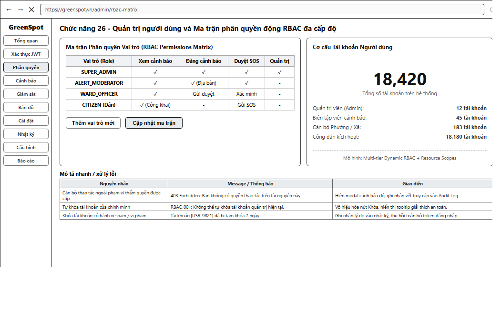
*Hình 4.26: Giao diện phác thảo Quản trị người dùng và Ma trận phân quyền động RBAC đa cấp độ*

*Bảng 4.26.1: Đặc tả thành phần giao diện chức năng 26 (Quản trị người dùng và Phân quyền RBAC)*
| Mã Phần Tử UI | Tên Thành Phần Giao Diện | Kiểu Điều Khiển UI | Chức Năng & Tương Tác Nghiệp Vụ |
| :--- | :--- | :--- | :--- |
| `USR_TXT_SEARCH` | Thanh tìm kiếm người dùng | Search Bar Input | Tìm kiếm theo Họ tên, Email, Số điện thoại hoặc Mã công dân. |
| `USR_DDL_ROLE_FILTER` | Bộ lọc vai trò | Dropdown Select | Lọc danh sách theo vai trò: Tất cả, Quản trị viên, Cán bộ cảnh báo, Công dân. |
| `USR_TBL_LIST` | Bảng danh sách tài khoản | Data Table (Pagination) | Hiển thị: Avatar, Họ tên, Email, Vai trò, Ngày tạo, Trạng thái (Active/Locked). |
| `USR_SWT_STATUS` | Công tắc Khóa / Kích hoạt | Toggle Switch | Bật/tắt trạng thái hoạt động của tài khoản người dùng. |
| `USR_MODAL_ROLE` | Hộp thoại phân vai trò | Dialog / Modal Window | Cho phép tích chọn vai trò mới và xác nhận cấp quyền. |

- **Quy tắc kiểm tra và thông báo lỗi (Validation & Error Handling)**:

*Bảng 4.26.2: Quy tắc kiểm tra và thông báo lỗi chức năng 26 (Quản trị người dùng và Phân quyền RBAC)*
| Trường Dữ Liệu / Tình Huống | Điều Kiện Ràng Buộc Kỹ Thuật | Mã Lỗi & Thông Điệp Phản Hồi Hiển Thị |
| :--- | :--- | :--- |
| Tự khóa tài khoản của mình | `user_id` tác động trùng với token hiện tại | `RBAC_001`: Bạn không thể tự khóa tài khoản quản trị của chính mình. |
| Thiếu lý do khóa tài khoản | Bắt buộc nhập lý do khi chuyển trạng thái Locked | `RBAC_002`: Vui lòng nhập lý do khóa tài khoản để ghi nhận kiểm toán an ninh. |
| Cấp quyền vượt cấp | Cán bộ thường không được gán quyền Super Admin | `RBAC_003`: Bạn không đủ thẩm quyền để gán vai trò Quản trị viên cấp cao. |
| Người dùng không tồn tại | ID tài khoản không có trong CSDL | `RBAC_004`: Không tìm thấy bản ghi người dùng yêu cầu. |

---

#### Chức năng 27: Hệ thống Nhật ký kiểm toán an ninh Audit Log và Giám sát truy vết biến động dữ liệu (Tamper-evident Security Audit Log & Action Tracking)
- **Mục tiêu nghiệp vụ**: Ghi nhận toàn diện, minh bạch và bất biến lịch sử các thao tác nghiệp vụ trọng yếu trong hệ thống (phát hành bản tin cảnh báo, duyệt tin báo khẩn cấp SOS, khóa/mở khóa tài khoản, thay đổi cấu hình ngưỡng ô nhiễm); lưu vết định danh người thực hiện, thời điểm, địa chỉ IP và dữ liệu trước/sau biến động; phục vụ giám sát và chống chối bỏ.
- **Tác nhân (Actor)**: Quản trị viên hệ thống (Super Admin), Chuyên viên kiểm toán an ninh.
- **Tiền điều kiện**: Quản trị viên đã xác thực hợp lệ; bảng `audit_logs` được kích hoạt cơ chế ghi tự động tại tầng cơ sở dữ liệu và middleware API.
- **Hậu điều kiện**: Mọi hành vi quản trị đều được lưu vết bền vững; dữ liệu nhật ký là chỉ đọc (Read-only), không ai có thể can thiệp xóa sửa qua giao diện.
- **Quy trình xử lý nghiệp vụ (Workflow)**:
  1. Khi có bất kỳ hành động thêm, sửa, xóa dữ liệu trên hệ thống, Middleware tự động trích xuất: User ID, Hành động, Bảng dữ liệu tác động, Địa chỉ IP, User Agent.
  2. Hệ thống đóng gói dữ liệu trạng thái cũ (Old Data) và dữ liệu mới (New Data) dưới định dạng JSONB và ghi vào bảng `audit_logs`.
  3. Quản trị viên mở trang "Nhật ký Kiểm toán An ninh" để kiểm tra các hoạt động trên cổng thông tin.
  4. Hệ thống tải bảng dữ liệu nhật ký mới nhất, đánh dấu màu đỏ các thao tác nhạy cảm hoặc có cờ bất thường (`is_suspicious=True`).
  5. Quản trị viên có thể bấm nút "Xem chi tiết" tại từng dòng để xem sự khác biệt dữ liệu (JSON Diff Viewer).
- **Luồng thay thế (Alternative Flow)**:
  - Lọc nhật ký theo khoảng thời gian và đối tượng: Quản trị viên chọn lọc theo ngày bắt đầu - ngày kết thúc và chọn loại hành động (VD: Chỉ xem các thao tác `PUBLISH_ALERT` hoặc `LOCK_USER`).
- **Luồng ngoại lệ (Exception Flow)**:
  - Thao tác đáng ngờ từ dải IP bất thường (ngoài Việt Nam hoặc IP ẩn danh Tor/Proxy): Hệ thống tự động gắn cờ `is_suspicious=True` và đẩy thông báo cảnh báo tức thì đến quản trị viên.
- **Mô tả thành phần giao diện (UI Specification)**:
  - Giao diện bảng dữ liệu Audit Log chuyên nghiệp, thanh lọc đa tiêu chí, thanh xem nhanh chi tiết bản ghi (JSON Diff Drawer), nhãn phân loại hành động màu sắc trực quan (Xanh: Create, Vàng: Update, Đỏ: Delete/Lock).

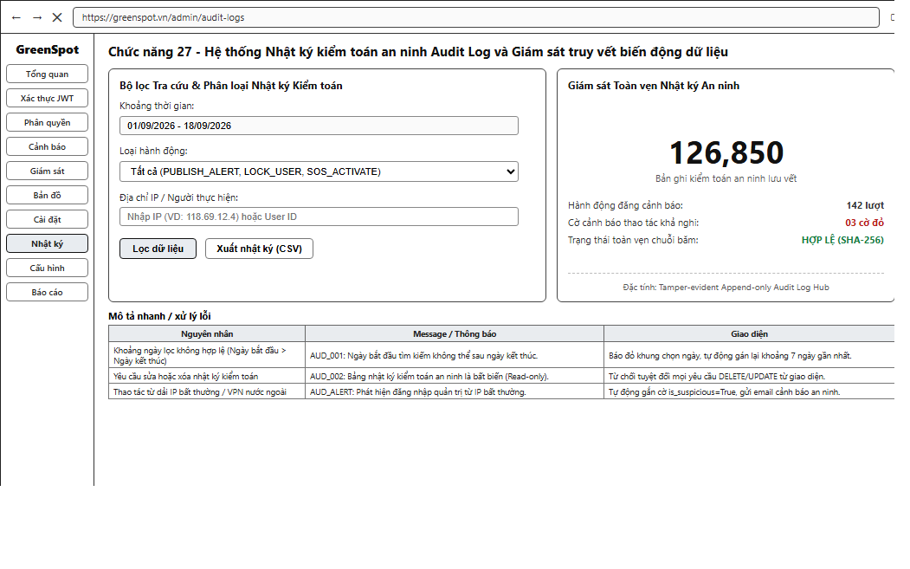
*Hình 4.27: Giao diện phác thảo Nhật ký kiểm toán an ninh Audit Log và Giám sát truy vết biến động dữ liệu*

*Bảng 4.27.1: Đặc tả thành phần giao diện chức năng 27 (Nhật ký kiểm toán an ninh Audit Log)*
| Mã Phần Tử UI | Tên Thành Phần Giao Diện | Kiểu Điều Khiển UI | Chức Năng & Tương Tác Nghiệp Vụ |
| :--- | :--- | :--- | :--- |
| `AUD_DATE_RANGE` | Bộ chọn khoảng thời gian | Date Range Picker | Chọn mốc thời gian Từ ngày - Đến ngày cần tra soát nhật ký. |
| `AUD_DDL_ACTION` | Lọc theo loại hành động | Multi-select Dropdown | Lọc các thao tác: Đăng cảnh báo, Khóa tài khoản, Sửa ngưỡng, Duyệt SOS. |
| `AUD_TBL_LOGS` | Bảng nhật ký kiểm toán | Data Grid Table | Hiển thị: Thời gian, Người thực hiện, Hành vi, Bảng đích, Địa chỉ IP, Trạng thái. |
| `AUD_BTN_VIEW_DIFF` | Nút xem chi tiết biến động | Icon Button (Eye) | Mở khung xem chi tiết so sánh dữ liệu cũ và dữ liệu mới (JSON Diff). |
| `AUD_BADGE_SUSPICIOUS` | Huy hiệu thao tác bất thường | Status Badge (Red) | Đánh dấu các bản ghi nghi vấn cần điều tra an ninh. |

- **Quy tắc kiểm tra và thông báo lỗi (Validation & Error Handling)**:

*Bảng 4.27.2: Quy tắc kiểm tra và thông báo lỗi chức năng 27 (Nhật ký kiểm toán an ninh Audit Log)*
| Trường Dữ Liệu / Tình Huống | Điều Kiện Ràng Buộc Kỹ Thuật | Mã Lỗi & Thông Điệp Phản Hồi Hiển Thị |
| :--- | :--- | :--- |
| Khoảng ngày lọc không hợp lệ | Ngày bắt đầu không được lớn hơn ngày kết thúc | `AUD_001`: Ngày bắt đầu tìm kiếm không thể sau ngày kết thúc. |
| Yêu cầu xóa nhật ký | Chặn tuyệt đối mọi lệnh `DELETE` trên bảng `audit_logs` | `AUD_002`: Bảng nhật ký kiểm toán an ninh là bất biến (Read-only), không được phép xóa. |
| Không tìm thấy bản ghi nhật ký | Bộ lọc không trả về kết quả | `AUD_003`: Không tìm thấy nhật ký biến động phù hợp với tiêu chí lọc. |

---

#### Chức năng 28: Trung tâm Biên tập và Phát hành Bản tin Cảnh báo Ô nhiễm Môi trường Khẩn cấp (Environmental Emergency Warning Publishing Center)
- **Mục tiêu nghiệp vụ**: Cung cấp công cụ cho cán bộ môi trường nhanh chóng soạn thảo, định dạng và phát hành các bản tin cảnh báo sự cố ô nhiễm (khí thải độc hại, ô nhiễm nguồn nước, mùi hôi nồng nặc, bãi rác cháy âm ỉ) đến cộng đồng; thiết lập mức độ cảnh báo (Vàng - Cam - Đỏ), khoanh vùng địa bàn hành chính chịu ảnh hưởng và đính kèm hướng dẫn phòng hộ sức khỏe cho nhân dân.
- **Tác nhân (Actor)**: Cán bộ quản lý môi trường, Ban biên tập cổng thông tin.
- **Tiền điều kiện**: Người dùng đăng nhập với quyền `PUBLISH_ENVIRONMENTAL_ALERT`.
- **Hậu điều kiện**: Bản tin cảnh báo được lưu trữ vào CSDL với trạng thái `ACTIVE_ALERT`; tự động hiển thị trên cổng thông tin công cộng và kích hoạt luồng thông báo đẩy.
- **Quy trình xử lý nghiệp vụ (Workflow)**:
  1. Cán bộ mở màn hình "Tạo Bản Tin Cảnh Báo Môi Trường" trên giao diện quản trị.
  2. Nhập tiêu đề bản tin cảnh báo (ngắn gọn, xúc tích), chọn loại sự cố ô nhiễm (Rác thải, Khói bụi, Nước bẩn, Khí độc).
  3. Chọn mức độ cảnh báo: **Cấp 1 - Vàng (Chú ý)**, **Cấp 2 - Cam (Nguy cơ cao)**, hoặc **Cấp 3 - Đỏ (Khẩn cấp nguy hại)**.
  4. Chọn địa bàn hành chính chịu ảnh hưởng (Quận/Huyện, Phường/Xã cụ thể) và nhập nội dung khuyến cáo an toàn cho người dân (VD: Đeo khẩu trang chống bụi mịn N95, không sử dụng nước giếng khoan, đóng kín cửa nhà).
  5. Cán bộ bấm "Phát hành cảnh báo", hệ thống hiển thị hộp thoại xác nhận và xuất bản bản tin lên toàn hệ thống.
- **Luồng thay thế (Alternative Flow)**:
  - Lưu bản nháp (Save Draft): Cán bộ soạn thảo bản tin nhưng chưa phát hành ngay, bấm "Lưu bản nháp" để chờ bổ sung kết quả trắc nghiệm mẫu nước/khí từ cơ quan chuyên môn.
- **Luồng ngoại lệ (Exception Flow)**:
  - Phát hành bản tin mức Đỏ (Khẩn cấp): Hệ thống yêu cầu xác nhận 2 bước (Xác nhận mật khẩu hoặc OTP cán bộ) để ngăn ngừa tình trạng phát nhầm thông tin gây hoang mang dư luận.
- **Mô tả thành phần giao diện (UI Specification)**:
  - Form soạn thảo bản tin hiện đại: Ô nhập tiêu đề lớn, bộ chọn màu mức độ cảnh báo (Vàng/Cam/Đỏ), danh sách chọn Phường/Quận nhiều lựa chọn (Tag Selector), khung nhập khuyến cáo y tế phòng hộ, nút Xem trước (Preview) và nút Phát hành.

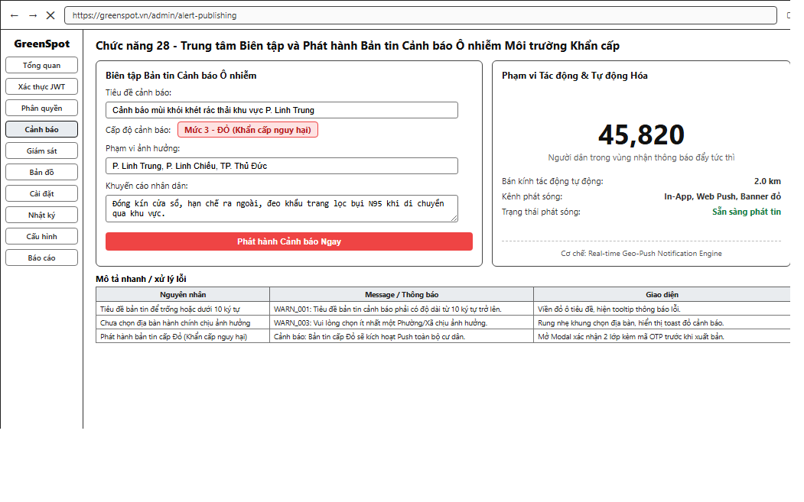
*Hình 4.28: Giao diện phác thảo Trung tâm Biên tập và Phát hành Bản tin Cảnh báo Ô nhiễm Môi trường Khẩn cấp*

*Bảng 4.28.1: Đặc tả thành phần giao diện chức năng 28 (Biên tập và Phát hành bản tin cảnh báo)*
| Mã Phần Tử UI | Tên Thành Phần Giao Diện | Kiểu Điều Khiển UI | Chức Năng & Tương Tác Nghiệp Vụ |
| :--- | :--- | :--- | :--- |
| `ALT_TXT_TITLE` | Tiêu đề bản tin cảnh báo | Text Input | Nhập tiêu đề sự cố cảnh báo (VD: Cảnh báo mùi khói khét khu vực P. Linh Trung). |
| `ALT_RDO_SEVERITY` | Chọn mức độ cảnh báo | Radio Button Group (Badge) | Chọn 1 trong 3 mức: Vàng (Chú ý) / Cam (Nguy cơ) / Đỏ (Khẩn cấp). |
| `ALT_SEL_DISTRICT` | Chọn địa bàn áp dụng | Multi-select Dropdown | Chọn một hoặc nhiều Phường/Quận chịu tác động của ô nhiễm. |
| `ALT_TXT_CONTENT` | Nội dung chi tiết sự cố | Rich Text Area | Nhập mô tả nguyên nhân, hiện trạng ô nhiễm và dự kiến thời gian kéo dài. |
| `ALT_TXT_SAFETY_ADVICE` | Khuyến cáo phòng hộ nhân dân | Text Area (Alert Box) | Nhập các biện pháp bảo vệ sức khỏe người dân cần thực hiện ngay. |
| `ALT_BTN_PUBLISH` | Nút phát hành bản tin | Danger Button | Kích hoạt phát hành bản tin cảnh báo ra toàn bộ cổng thông tin. |

- **Quy tắc kiểm tra và thông báo lỗi (Validation & Error Handling)**:

*Bảng 4.28.2: Quy tắc kiểm tra và thông báo lỗi chức năng 28 (Biên tập và Phát hành bản tin cảnh báo)*
| Trường Dữ Liệu / Tình Huống | Điều Kiện Ràng Buộc Kỹ Thuật | Mã Lỗi & Thông Điệp Phản Hồi Hiển Thị |
| :--- | :--- | :--- |
| Tiêu đề bản tin quá ngắn | Độ dài bắt buộc từ 10 đến 255 ký tự | `WARN_001`: Tiêu đề bản tin cảnh báo phải có độ dài từ 10 ký tự trở lên. |
| Chưa chọn mức độ cảnh báo | Bắt buộc chọn 1 trong 3 mức Vàng/Cam/Đỏ | `WARN_002`: Vui lòng chọn mức độ cảnh báo phù hợp. |
| Chưa chọn địa bàn áp dụng | Danh sách địa bàn phải có ít nhất 1 đơn vị | `WARN_003`: Vui lòng chọn ít nhất một Phường/Xã chịu ảnh hưởng. |
| Thiếu nội dung khuyến cáo | Bắt buộc nhập khuyến cáo phòng hộ cho dân | `WARN_004`: Nội dung khuyến cáo an toàn cho người dân không được để trống. |

---

#### Chức năng 29: Hệ thống Điều phối Thông báo Đẩy (Push Notification) Cảnh báo Ô nhiễm theo Thời gian thực (Real-time Pollution Alert Dispatching & Push Notification System)
- **Mục tiêu nghiệp vụ**: Tự động hóa quá trình phân phối thông tin cảnh báo: Ngay khi bản tin cảnh báo ô nhiễm được phát hành (từ Chức năng 28), hệ thống lập tức điều phối gửi thông báo tức thời (In-App Notification qua biểu tượng Chuông và Web Push Notification trên trình duyệt) đến tài khoản của những người dân đang sinh sống hoặc theo dõi địa bàn đó.
- **Tác nhân (Actor)**: Hệ thống tự động, Công dân đô thị, Cán bộ quản lý.
- **Tiền điều kiện**: Bản tin cảnh báo được xuất bản ở trạng thái `ACTIVE_ALERT`; người dân đã bật cho phép nhận thông báo trên cổng thông tin.
- **Hậu điều kiện**: Các bản ghi thông báo được tạo tự động trong bảng `notifications`; chuông thông báo trên giao diện công dân hiện chấm đỏ kèm số lượng tin mới.
- **Quy trình xử lý nghiệp vụ (Workflow)**:
  1. Khi sự kiện `ALERT_PUBLISHED` được kích hoạt, hệ thống tự động quét danh sách người dùng đã đăng ký theo dõi địa bàn tương ứng (từ bảng cấu hình nhận tin).
  2. Hệ thống tạo các bản ghi thông báo tương ứng trong bảng `notifications` với loại `POLLUTION_ALERT` và mức độ nghiêm trọng tương ứng.
  3. Gửi lệnh thông báo Web Push đến trình duyệt của người dùng (nếu người dùng đang trực tuyến).
  4. Người dân nhìn thấy biểu tượng Chuông thông báo góc phải màn hình rung nhẹ và hiện chấm đỏ báo hiệu có tin khẩn.
  5. Người dân bấm vào Chuông thông báo -> Xem danh sách thẻ tóm tắt -> Bấm vào tin để mở trang chi tiết hướng dẫn an toàn.
- **Luồng thay thế (Alternative Flow)**:
  - Đánh dấu đã đọc tất cả: Người dân bấm nút "Đánh dấu tất cả là đã đọc", hệ thống cập nhật `is_read=True` cho toàn bộ các thông báo của người dùng đó.
- **Luồng ngoại lệ (Exception Flow)**:
  - Trình duyệt chặn thông báo Push: Hệ thống tự động chuyển sang cơ chế thông báo nội bộ (In-App Banner) khi người dân truy cập vào bất kỳ trang nào của hệ thống.
- **Mô tả thành phần giao diện (UI Specification)**:
  - Nút biểu tượng Chuông (Bell Icon) kèm huy hiệu số lượng tin chưa đọc (Badge Counter); Menu thả xuống (Dropdown Panel) chứa danh sách các thông báo cảnh báo phân màu theo mức độ (Vàng/Cam/Đỏ); Nút "Xem tất cả thông báo" và nút "Đánh dấu đã đọc".

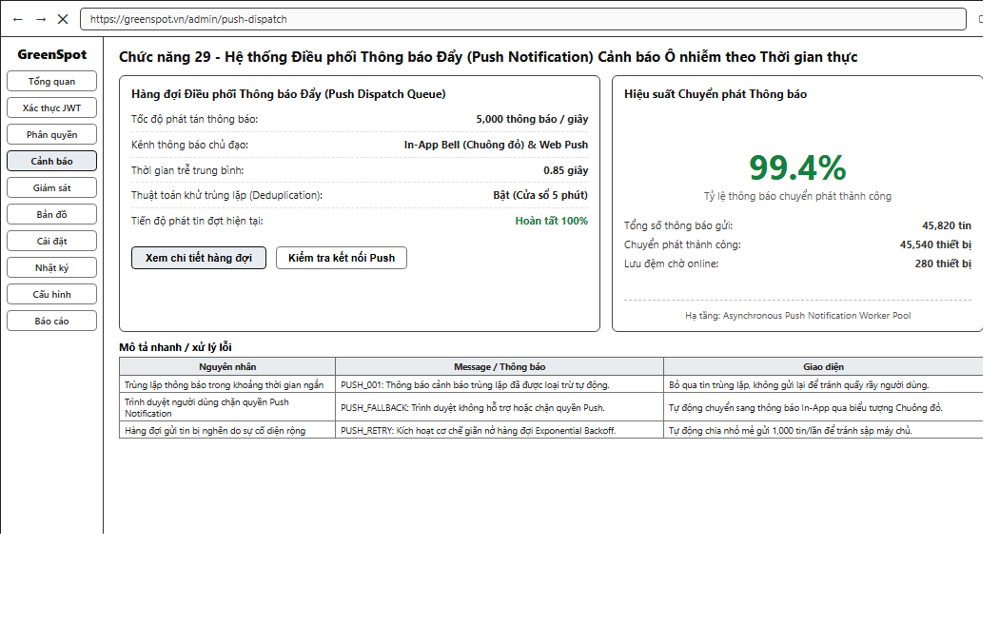
*Hình 4.29: Giao diện phác thảo Điều phối Thông báo Đẩy (Push Notification) Cảnh báo Ô nhiễm theo Thời gian thực*

*Bảng 4.29.1: Đặc tả thành phần giao diện chức năng 29 (Điều phối thông báo đẩy thời gian thực)*
| Mã Phần Tử UI | Tên Thành Phần Giao Diện | Kiểu Điều Khiển UI | Chức Năng & Tương Tác Nghiệp Vụ |
| :--- | :--- | :--- | :--- |
| `NOTI_BTN_BELL` | Biểu tượng Chuông thông báo | Icon Button (Bell) | Nằm trên thanh điều hướng Header; hiện số lượng tin cảnh báo mới. |
| `NOTI_PANEL_DROPDOWN` | Khung danh sách thông báo | Dropdown Popup Panel | Hiển thị 5 tin cảnh báo mới nhất kèm thời gian và nhãn mức độ ô nhiễm. |
| `NOTI_CARD_ITEM` | Thẻ thông báo cảnh báo | List Item Card | Chứa icon loại ô nhiễm, tiêu đề, tóm tắt và mốc thời gian (VD: 5 phút trước). |
| `NOTI_BTN_MARK_ALL` | Nút đánh dấu đã đọc | Link Button | Cập nhật toàn bộ thông báo sang trạng thái đã xem. |
| `NOTI_PAGE_CENTER` | Trung tâm thông báo cá nhân | Full Page View | Trang danh sách chi tiết toàn bộ các thông báo cảnh báo đã nhận theo thời gian. |

- **Quy tắc kiểm tra và thông báo lỗi (Validation & Error Handling)**:

*Bảng 4.29.2: Quy tắc kiểm tra và thông báo lỗi chức năng 29 (Điều phối thông báo đẩy thời gian thực)*
| Trường Dữ Liệu / Tình Huống | Điều Kiện Ràng Buộc Kỹ Thuật | Mã Lỗi & Thông Điệp Phản Hồi Hiển Thị |
| :--- | :--- | :--- |
| Trùng lặp thông báo | Cơ chế Deduplication không gửi 2 tin cùng nội dung trong 5 phút | `PUSH_001`: Thông báo cảnh báo trùng lặp đã được loại trừ tự động. |
| Không thể tải thông báo | Lỗi kết nối mạng hoặc API thông báo gián đoạn | `PUSH_002`: Không thể cập nhật thông báo mới. Vui lòng tải lại trang. |
| Đánh dấu đọc tin không hợp lệ | ID thông báo không thuộc quyền sở hữu của user | `PUSH_003`: Thao tác không hợp lệ trên thông báo của tài khoản khác. |

---

#### Chức năng 30: Cổng Tra cứu Công khai Tiến độ và Lịch sử Xử lý Sự cố Dành cho Người Dân (Citizen Public Incident Tracking & Transparency Portal)
- **Mục tiêu nghiệp vụ**: Tăng cường tính công khai, minh bạch và nâng cao niềm tin của nhân dân đối với công tác bảo vệ môi trường của chính quyền đô thị; cho phép bất kỳ người dân nào chỉ cần nhập Mã theo dõi sự cố (VD: `INC-2026-0042`) là có thể xem toàn bộ tiến trình: Thời điểm tiếp nhận, cơ quan phụ trách, hiện trạng xử lý và hình ảnh hiện trường Before/After mà **hoàn toàn không bắt buộc phải đăng nhập tài khoản**.
- **Tác nhân (Actor)**: Mọi công dân, Báo chí, Tổ chức xã hội.
- **Tiền điều kiện**: Sự cố đã được gửi lên hệ thống và đã được cấp Mã tra cứu hợp lệ (`tracking_code`).
- **Hậu điều kiện**: Hiển thị công khai toàn bộ lộ trình tiến độ; tự động che/ẩn (Masking) thông tin cá nhân của người phản ánh ban đầu để bảo đảm quyền riêng tư.
- **Quy trình xử lý nghiệp vụ (Workflow)**:
  1. Người dân truy cập Cổng thông tin GreenSpot, nhìn thấy ô tìm kiếm "Tra Cứu Tiến Độ Sự Cố Môi Trường" nổi bật ngay tại đầu trang chủ.
  2. Người dân nhập mã theo dõi sự cố (được cấp khi báo cáo hoặc được chia sẻ trong cộng đồng) và bấm nút "Tra Cứu".
  3. Hệ thống kiểm tra tính hợp lệ của mã, truy vấn dữ liệu từ bảng `incidents` và `incident_status_history`.
  4. Hệ thống áp dụng quy tắc ẩn danh: Số điện thoại người báo cáo chỉ hiển thị dạng `090****567`, họ tên được ẩn để bảo vệ người dân.
  5. Giao diện hiển thị thước tiến trình (Timeline Stepper): [1. Đã Tiếp Nhận] -> [2. Đang Phân Loại / Kiểm Tra] -> [3. Đã Xử Lý Xong], kèm hình ảnh hiện trường Before/After và văn bản phản hồi chính thức.
- **Luồng thay thế (Alternative Flow)**:
  - Quét mã QR tra cứu: Người dân dùng camera điện thoại quét mã QR được in trên biên nhận hoặc chia sẻ trên mạng xã hội, trình duyệt tự động mở thẳng đến trang tiến độ sự cố tương ứng.
- **Luồng ngoại lệ (Exception Flow)**:
  - Nhập sai mã theo dõi hoặc sự cố đã bị xóa do vi phạm quy chế: Hệ thống hiển thị thông báo "Không tìm thấy hồ sơ sự cố tương ứng", kèm hướng dẫn kiểm tra lại cú pháp mã.
- **Mô tả thành phần giao diện (UI Specification)**:
  - Thanh tìm kiếm tra cứu trung tâm (Search Box lớn với icon kính lúp); Khung chi tiết hồ sơ sự cố gồm: Thẻ tóm tắt thông tin (Địa chỉ, Loại ô nhiễm, Thời gian báo); Thước tiến trình xử lý trực quan (Timeline Stepper) với icon trạng thái; Khung trình chiếu ảnh Before/After đối chiếu; Hộp thông điệp phản hồi từ cơ quan môi trường.

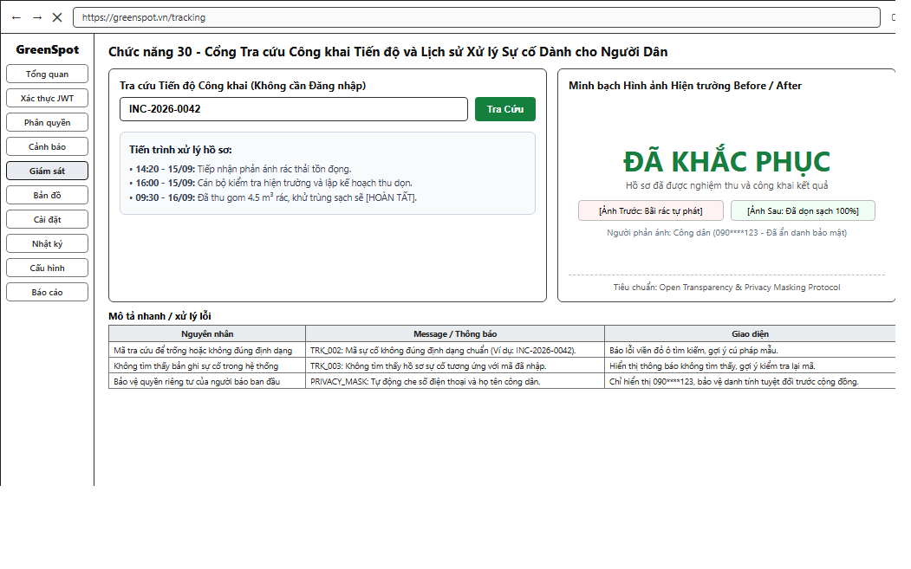
*Hình 4.30: Giao diện phác thảo Cổng Tra cứu Công khai Tiến độ và Lịch sử Xử lý Sự cố Dành cho Người Dân*

*Bảng 4.30.1: Đặc tả thành phần giao diện chức năng 30 (Cổng tra cứu công khai tiến độ sự cố)*
| Mã Phần Tử UI | Tên Thành Phần Giao Diện | Kiểu Điều Khiển UI | Chức Năng & Tương Tác Nghiệp Vụ |
| :--- | :--- | :--- | :--- |
| `TRK_TXT_CODE` | Ô nhập mã tra cứu sự cố | Large Search Input | Nhập mã định danh sự cố (VD: `INC-2026-0042`). |
| `TRK_BTN_SEARCH` | Nút thực hiện tra cứu | Primary Action Button | Kích hoạt gọi API tra cứu công khai không cần token đăng nhập. |
| `TRK_STEP_TIMELINE` | Thước tiến trình thời gian | Horizontal Stepper | Thể hiện 3-4 chặng tiến độ: Tiếp nhận -> Kiểm tra -> Đã giải quyết. |
| `TRK_IMG_BEFORE_AFTER` | Khung hiển thị ảnh hiện trường | Image Comparison Slider | Trình chiếu ảnh lúc ô nhiễm và ảnh sau khi đã được dọn sạch minh bạch. |
| `TRK_BOX_RESPONSE` | Hộp phản hồi từ chính quyền | Information Alert Box | Hiển thị nội dung thông báo kết quả giải quyết từ cơ quan chức năng. |

- **Quy tắc kiểm tra và thông báo lỗi (Validation & Error Handling)**:

*Bảng 4.30.2: Quy tắc kiểm tra và thông báo lỗi chức năng 30 (Cổng tra cứu công khai tiến độ sự cố)*
| Trường Dữ Liệu / Tình Huống | Điều Kiện Ràng Buộc Kỹ Thuật | Mã Lỗi & Thông Điệp Phản Hồi Hiển Thị |
| :--- | :--- | :--- |
| Mã tra cứu để trống | Không được để trống chuỗi tìm kiếm | `TRK_001`: Vui lòng nhập mã theo dõi sự cố cần tra cứu. |
| Định dạng mã không đúng | Phải khớp Regex `^INC-[0-9]{4}-[0-9]{4,6}$` | `TRK_002`: Mã sự cố không đúng định dạng chuẩn (Ví dụ đúng: INC-2026-0042). |
| Không tìm thấy hồ sơ | Mã tra cứu không tồn tại trong CSDL | `TRK_003`: Không tìm thấy hồ sơ sự cố tương ứng với mã đã nhập. |
| Hồ sơ bị ẩn | Sự cố nhạy cảm bị cơ quan chức năng tạm khóa công khai | `TRK_004`: Hồ sơ này đang trong quá trình bảo mật nghiệp vụ kiểm tra. |

---

#### Chức năng 31: Bản đồ Giám sát Hiện trạng Điểm Cảnh báo Ô nhiễm Trực quan cho Cộng đồng (Public Environmental Status Live Map & Visual Alert Viewer)
- **Mục tiêu nghiệp vụ**: Cung cấp giao diện bản đồ không gian địa lý trực quan cho người dân theo dõi tình trạng môi trường đô thị xung quanh mình; các điểm cảnh báo ô nhiễm đang hoạt động được hiển thị với biểu tượng và màu sắc trực quan (Xanh: Khu vực bình thường, Vàng: Ô nhiễm nhẹ/chú ý, Cam: Nguy cơ ô nhiễm trung bình, Đỏ: Điểm nóng ô nhiễm nghiêm trọng); giúp người dân chủ động né tránh các điểm ô nhiễm khi di chuyển hoặc sinh hoạt.
- **Tác nhân (Actor)**: Toàn thể công dân đô thị, Khách vãng lai, Ban chỉ đạo môi trường.
- **Tiền điều kiện**: Thiết bị người dùng hỗ trợ GPS/trình duyệt Web; API dịch vụ bản đồ số hoạt động bình thường.
- **Hậu điều kiện**: Bản đồ tải đầy đủ các điểm cảnh báo ô nhiễm đang có hiệu lực trong phạm vi xem; người dùng bấm vào điểm để xem thông tin tóm tắt và khuyến cáo.
- **Quy trình xử lý nghiệp vụ (Workflow)**:
  1. Người dân mở trang "Bản Đồ Cảnh Báo Môi Trường" trên Cổng thông tin GreenSpot.
  2. Trình duyệt hỏi quyền truy cập vị trí hiện tại (Geolocation); nếu đồng ý, bản đồ tự động căn tâm (Center) về vị trí của người dân.
  3. Hệ thống tải danh sách các điểm ô nhiễm và bản tin cảnh báo đang hoạt động trong bán kính xung quanh.
  4. Các điểm ô nhiễm được hiển thị bằng các Marker màu sắc tương ứng theo mức độ cảnh báo (Vàng/Cam/Đỏ) kèm kỹ thuật phân cụm Marker (Clustering) để tránh rối mắt.
  5. Người dân bấm vào một Marker bất kỳ -> Mở cửa sổ Popup hiển thị: Ảnh hiện trường thu nhỏ, Loại ô nhiễm, Cấp độ cảnh báo và Lời khuyên phòng hộ sức khỏe.
- **Luồng thay thế (Alternative Flow)**:
  - Bật/tắt lớp chuyên đề (Layer Filter): Người dân dùng bộ lọc trên bản đồ để chỉ xem riêng các điểm ô nhiễm Khói bụi hoặc chỉ xem các điểm ô nhiễm Rác thải/Nguồn nước.
- **Luồng ngoại lệ (Exception Flow)**:
  - Người dùng từ chối quyền định vị GPS: Bản đồ tự động lấy vị trí mặc định tại trung tâm Thành phố (VD: Tòa nhà UBND TP.HCM, Quận 1) và hiển thị thanh tìm kiếm địa chỉ thủ công.
- **Mô tả thành phần giao diện (UI Specification)**:
  - Khung bản đồ toàn màn hình (sử dụng Leaflet / OpenStreetMap mã nguồn mở nhẹ nhàng, tải nhanh); Bộ lọc phân loại nổi góc trái; Cụm nút điều khiển bản đồ (Zoom In/Out, Định vị vị trí tôi); Cửa sổ Popup thông tin điểm cảnh báo; Chú giải màu sắc bản đồ (Legend: Xanh/Vàng/Cam/Đỏ) ở góc dưới.

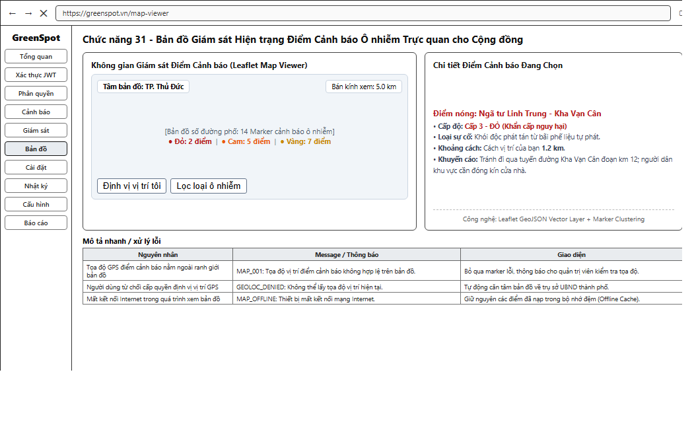
*Hình 4.31: Giao diện phác thảo Bản đồ Giám sát Hiện trạng Điểm Cảnh báo Ô nhiễm Trực quan cho Cộng đồng*

*Bảng 4.31.1: Đặc tả thành phần giao diện chức năng 31 (Bản đồ giám sát điểm cảnh báo ô nhiễm)*
| Mã Phần Tử UI | Tên Thành Phần Giao Diện | Kiểu Điều Khiển UI | Chức Năng & Tương Tác Nghiệp Vụ |
| :--- | :--- | :--- | :--- |
| `MAP_CONTAINER` | Khung hiển thị bản đồ Leaflet | Interactive Map Canvas | Hiển thị nền bản đồ đường phố và các Marker cảnh báo. |
| `MAP_BTN_MY_LOC` | Nút định vị vị trí của tôi | Floating Action Button | Căn tâm bản đồ về tọa độ GPS hiện tại của thiết bị người dùng. |
| `MAP_LAYER_FILTER` | Bộ lọc lớp ô nhiễm | Floating Checklist Box | Bật/tắt hiển thị điểm theo loại: Rác thải, Khói bụi, Nước thải, Khí độc. |
| `MAP_POPUP_INFO` | Hộp thoại thông tin điểm nóng | Map Popup Window | Hiện tên điểm, ảnh, mức độ cảnh báo, khoảng cách từ người xem đến điểm ô nhiễm. |
| `MAP_LEGEND` | Bảng chú giải cấp độ cảnh báo | Bottom-Right Card | Giải thích ý nghĩa màu sắc: Vàng (Chú ý), Cam (Nguy cơ), Đỏ (Khẩn cấp). |

- **Quy tắc kiểm tra và thông báo lỗi (Validation & Error Handling)**:

*Bảng 4.31.2: Quy tắc kiểm tra và thông báo lỗi chức năng 31 (Bản đồ giám sát điểm cảnh báo ô nhiễm)*
| Trường Dữ Liệu / Tình Huống | Điều Kiện Ràng Buộc Kỹ Thuật | Mã Lỗi & Thông Điệp Phản Hồi Hiển Thị |
| :--- | :--- | :--- |
| Tọa độ không hợp lệ | Vĩ độ [-90, 90], Kinh độ [-180, 180] | `MAP_001`: Tọa độ vị trí điểm cảnh báo không hợp lệ trên bản đồ. |
| Lỗi tải dữ liệu không gian | Không kết nối được tới máy chủ GeoJSON | `MAP_002`: Không thể tải dữ liệu điểm cảnh báo môi trường. Vui lòng thử lại. |
| Thiết bị mất kết nối mạng | Thiết bị người dùng ngắt kết nối Internet | `MAP_003`: Bản đồ ngoại tuyến. Vui lòng kiểm tra lại kết nối mạng. |

---

#### Chức năng 32: Cơ chế Đăng ký Nhận Tin Cảnh báo Cá nhân hóa theo Khu Vực / Địa Bàn Cư Trú (Personalized Area Subscription & Pollution Alert Preferences)
- **Mục tiêu nghiệp vụ**: Cá nhân hóa trải nghiệm công dân: Cho phép người dân chủ động thiết lập danh sách các khu vực địa lý mình quan tâm (Nơi ở, Nơi làm việc, Trường học của con em) và loại hình ô nhiễm quan tâm (Khói bụi, Rác thải, Mùi hôi, Ngập rác); từ đó hệ thống chỉ gửi các thông báo cảnh báo sát sườn, đúng nhu cầu, tránh làm phiền người dân với các tin tức ngoài khu vực sinh sống.
- **Tác nhân (Actor)**: Công dân có tài khoản trên cổng thông tin.
- **Tiền điều kiện**: Người dân đã đăng nhập tài khoản vào hệ thống.
- **Hậu điều kiện**: Cấu hình đăng ký nhận tin của người dân được lưu trữ vào CSDL; hệ thống sử dụng cấu hình này làm bộ lọc khi phát thông báo cảnh báo tự động.
- **Quy trình xử lý nghiệp vụ (Workflow)**:
  1. Người dân vào mục "Cài Đặt Cá Nhân" -> chọn tab "Đăng Ký Nhận Tin Cảnh Báo Khu Vực".
  2. Hệ thống hiển thị danh sách các Quận/Huyện và Phường/Xã trên toàn thành phố dưới dạng danh sách chọn.
  3. Người dân tích chọn các Phường/Xã mình muốn theo dõi (tối đa 5 khu vực) và chọn mức độ cảnh báo tối thiểu muốn nhận (VD: Chỉ nhận cảnh báo mức Cam và Đỏ).
  4. Người dân chọn kênh nhận thông báo mong muốn: [x] Thông báo trên Cổng thông tin (In-App), [x] Thông báo qua Email.
  5. Bấm nút "Lưu Cài Đặt", hệ thống cập nhật cấu hình vào CSDL và hiển thị thông báo thiết lập thành công.
- **Luồng thay thế (Alternative Flow)**:
  - Tắt hoàn toàn thông báo (Mute All): Người dân có thể gạt công tắc "Tạm ngưng nhận cảnh báo" trong các khoảng thời gian đi công tác hoặc nghỉ lễ.
- **Luồng ngoại lệ (Exception Flow)**:
  - Đăng ký vượt quá giới hạn khu vực: Người dùng chọn nhiều hơn 5 khu vực, hệ thống phát cảnh báo và hướng dẫn tối ưu phạm vi theo dõi.
- **Mô tả thành phần giao diện (UI Specification)**:
  - Giao diện dạng form cài đặt trực quan: Khung chọn Quận/Huyện và Phường/Xã bằng danh sách checkbox; Thẻ gạt công tắc cho từng kênh nhận tin; Thanh trượt chọn mức cảnh báo tối thiểu (Slider: Vàng -> Cam -> Đỏ); Nút "Lưu Cấu Hình".

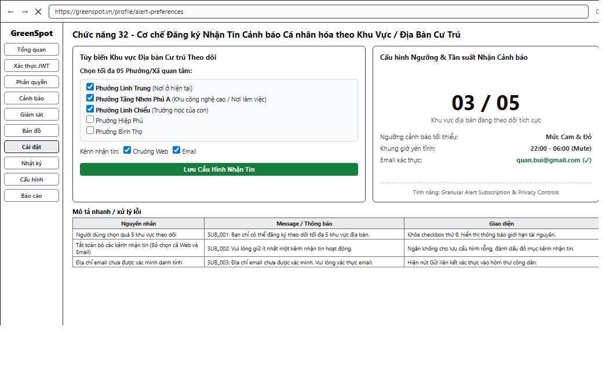
*Hình 4.32: Giao diện phác thảo Cơ chế Đăng ký Nhận Tin Cảnh báo Cá nhân hóa theo Khu Vực Cư Trú*

*Bảng 4.32.1: Đặc tả thành phần giao diện chức năng 32 (Đăng ký nhận tin cảnh báo cá nhân hóa)*
| Mã Phần Tử UI | Tên Thành Phần Giao Diện | Kiểu Điều Khiển UI | Chức Năng & Tương Tác Nghiệp Vụ |
| :--- | :--- | :--- | :--- |
| `SUB_CHK_DISTRICTS` | Danh sách checkbox Phường/Quận | Multi-checkbox Tree | Chọn các khu vực địa bàn hành chính người dân muốn nhận tin. |
| `SUB_SLD_MIN_LEVEL` | Thanh chọn mức độ cảnh báo | Slider / Segmented Control | Chọn ngưỡng cảnh báo tối thiểu: Nhận tất cả / Chỉ mức Cam & Đỏ / Chỉ mức Đỏ. |
| `SUB_SWT_IN_APP` | Công tắc nhận tin qua Web | Toggle Switch | Bật/tắt nhận chuông thông báo trên Cổng thông tin GreenSpot. |
| `SUB_SWT_EMAIL` | Công tắc nhận tin qua Email | Toggle Switch | Bật/tắt gửi email cảnh báo khi có sự cố nghiêm trọng ở địa bàn đã chọn. |
| `SUB_BTN_SAVE` | Nút lưu cấu hình | Primary Button | Gửi yêu cầu cập nhật sở thích nhận tin lên máy chủ. |

- **Quy tắc kiểm tra và thông báo lỗi (Validation & Error Handling)**:

*Bảng 4.32.2: Quy tắc kiểm tra và thông báo lỗi chức năng 32 (Đăng ký nhận tin cảnh báo cá nhân hóa)*
| Trường Dữ Liệu / Tình Huống | Điều Kiện Ràng Buộc Kỹ Thuật | Mã Lỗi & Thông Điệp Phản Hồi Hiển Thị |
| :--- | :--- | :--- |
| Chọn quá 5 khu vực | Giới hạn tối đa 5 Phường/Xã cho 1 tài khoản | `SUB_001`: Bạn chỉ có thể đăng ký theo dõi tối đa 5 khu vực địa bàn. |
| Tắt toàn bộ kênh nhận tin | Phải giữ ít nhất 1 kênh nhận tin kích hoạt | `SUB_002`: Vui lòng giữ ít nhất một kênh nhận tin (Web hoặc Email) hoạt động. |
| Email nhận tin không hợp lệ | Nếu bật nhận email, email phải được xác thực | `SUB_003`: Địa chỉ email chưa được xác minh. Vui lòng xác thực email trước. |

---

#### Chức năng 33: Bảng Tổng quan Chỉ số Hiện trạng Môi trường Đô thị Công cộng (Public Environmental Status Index & Public Transparency Dashboard)
- **Mục tiêu nghiệp vụ**: Xây dựng bức tranh toàn cảnh về chất lượng môi trường và nỗ lực bảo vệ môi trường đô thị cho toàn thể nhân dân cùng giám sát; công khai các số liệu: Tổng số cảnh báo ô nhiễm đang có hiệu lực, số lượng sự cố đã được khắc phục hoàn tất trong tháng, tỷ lệ các khu vực đạt chuẩn môi trường xanh (Green Zone Rate); trực quan hóa bằng các biểu đồ sinh động.
- **Tác nhân (Actor)**: Toàn thể nhân dân đô thị, Khách vãng lai, Cơ quan báo chí, Các tổ chức môi trường.
- **Tiền điều kiện**: Hệ thống có dữ liệu về các sự cố và bản tin cảnh báo; máy chủ kích hoạt cơ chế tự động tổng hợp số liệu định kỳ (Cached Aggregation).
- **Hậu điều kiện**: Hiển thị bảng điều khiển công khai với các chỉ số môi trường cập nhật theo thời gian thực; tốc độ tải trang dưới 1 giây.
- **Quy trình xử lý nghiệp vụ (Workflow)**:
  1. Người dân truy cập vào trang chủ hoặc mục "Chỉ Số Môi Trường Đô Thị" trên Cổng thông tin.
  2. Hệ thống tải dữ liệu tổng hợp đã được lưu đệm (Cache) từ bảng `reports` và `incidents`.
  3. Màn hình hiển thị 4 thẻ số liệu KPI lớn nổi bật trên đầu trang:
     - (1) **Cảnh báo đang hoạt động**: 12 điểm.
     - (2) **Sự cố đã khắc phục thành công**: 1,420 điểm.
     - (3) **Tỷ lệ khu vực an toàn**: 94.2%.
     - (4) **Thời gian phản hồi trung bình**: 3.5 giờ.
  4. Hiển thị Biểu đồ tròn (Pie Chart) phân tích tỷ lệ các loại ô nhiễm (Rác sinh hoạt 60%, Khói bụi 20%, Nước thải 15%, Khác 5%).
  5. Hiển thị Biểu đồ cột (Bar Chart) so sánh số lượng cảnh báo giữa các Quận/Huyện để người dân có góc nhìn so sánh trực quan.
- **Luồng thay thế (Alternative Flow)**:
  - Xem số liệu theo khoảng thời gian: Người dân chọn xem theo tuần này, tháng này hoặc quý này; biểu đồ tự động chuyển đổi dữ liệu tương ứng.
- **Luồng ngoại lệ (Exception Flow)**:
  - Máy chủ CSDL đang tính toán lại số liệu nặng: Hệ thống trả về dữ liệu lưu đệm gần nhất (Stale-While-Revalidate) để không làm gián đoạn trải nghiệm người dân.
- **Mô tả thành phần giao diện (UI Specification)**:
  - Bảng điều khiển giao diện phẳng, hiện đại: Hàng thẻ Card số liệu KPI có viền màu nổi bật; Khung biểu đồ tròn phân tích loại ô nhiễm; Khung biểu đồ cột diễn biến theo thời gian; Bảng xếp hạng Top 5 phường có môi trường xanh sạch nhất.

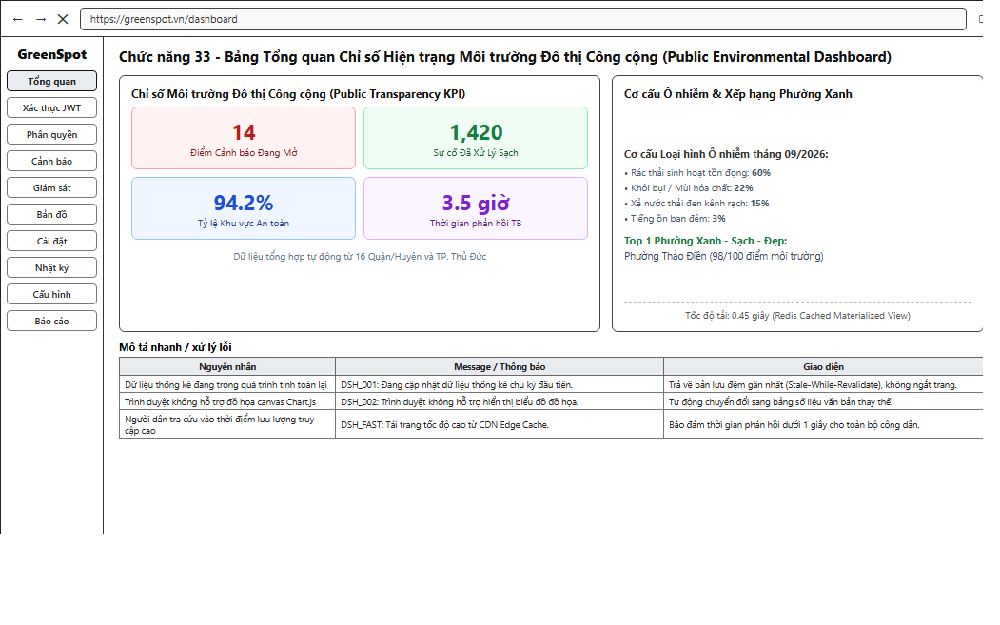
*Hình 4.33: Giao diện phác thảo Bảng Tổng quan Chỉ số Hiện trạng Môi trường Đô thị Công cộng (Public Environmental Dashboard)*

*Bảng 4.33.1: Đặc tả thành phần giao diện chức năng 33 (Bảng tổng quan chỉ số môi trường công cộng)*
| Mã Phần Tử UI | Tên Thành Phần Giao Diện | Kiểu Điều Khiển UI | Chức Năng & Tương Tác Nghiệp Vụ |
| :--- | :--- | :--- | :--- |
| `DSH_CARD_ACTIVE_ALERTS` | Thẻ số cảnh báo đang mở | Stat Card Widget (Red) | Hiển thị tổng số điểm ô nhiễm đang cảnh báo trong thành phố. |
| `DSH_CARD_RESOLVED` | Thẻ số điểm đã xử lý sạch | Stat Card Widget (Green) | Hiển thị tổng số điểm rác đã được khắc phục hoàn tất. |
| `DSH_CARD_SAFETY_RATE` | Thẻ tỷ lệ khu vực an toàn | Stat Card Widget (Blue) | Tỷ lệ phần trăm các khu phố không có ô nhiễm nghiêm trọng. |
| `DSH_CHART_PIE_TYPE` | Biểu đồ tròn loại ô nhiễm | Chart.js Canvas | Thể hiện cơ cấu các loại ô nhiễm: Rác thải, Khí thải, Nước bẩn. |
| `DSH_CHART_BAR_DISTRICT`| Biểu đồ cột theo quận huyện | Chart.js Canvas | So sánh mức độ ô nhiễm giữa các đơn vị hành chính. |
| `DSH_TBL_TOP_GREEN` | Bảng vinh danh Phường Xanh | Ranking Table | Bảng xếp hạng các phường sạch sẽ và tích cực nhất. |

- **Quy tắc kiểm tra và thông báo lỗi (Validation & Error Handling)**:

*Bảng 4.33.2: Quy tắc kiểm tra và thông báo lỗi chức năng 33 (Bảng tổng quan chỉ số môi trường công cộng)*
| Trường Dữ Liệu / Tình Huống | Điều Kiện Ràng Buộc Kỹ Thuật | Mã Lỗi & Thông Điệp Phản Hồi Hiển Thị |
| :--- | :--- | :--- |
| Dữ liệu thống kê rỗng | Khi hệ thống mới triển khai chưa có sự cố | `DSH_001`: Đang cập nhật dữ liệu thống kê chu kỳ đầu tiên. |
| Lỗi thư viện biểu đồ | Trình duyệt cũ không hỗ trợ canvas HTML5 | `DSH_002`: Trình duyệt không hỗ trợ hiển thị biểu đồ đồ họa. |
| Quá hạn bộ đệm cache | Cache quá 30 phút tự động kích hoạt refresh | `DSH_003`: Dữ liệu số liệu đang được làm mới tự động. |

---

#### Chức năng 34: Quản trị Ngưỡng Kích hoạt Cảnh báo và Phân loại Mức độ Nghiêm trọng Sự cố (Pollution Alert Thresholds & Severity Rule Management)
- **Mục tiêu nghiệp vụ**: Chuẩn hóa danh mục quy chuẩn và chính sách kích hoạt cảnh báo ô nhiễm môi trường tự động: Cho phép quản trị viên thiết lập định mức bán kính ảnh hưởng và nội dung hướng dẫn y tế phòng hộ mặc định tương ứng với từng cấp độ cảnh báo (Vàng: Chú ý, Cam: Nguy cơ, Đỏ: Khẩn cấp nguy hại); đảm bảo tính nhất quán của thông điệp cảnh báo gửi đến nhân dân.
- **Tác nhân (Actor)**: Quản trị viên hệ thống (Super Admin), Chuyên gia môi trường đô thị.
- **Tiền điều kiện**: Quản trị viên đăng nhập với quyền `ADMIN_SYSTEM_CONFIG`.
- **Hậu điều kiện**: Các tham số quy chuẩn cảnh báo được cập nhật vào bảng `system_configs` và `waste_categories`; có hiệu lực ngay trong các lần phát cảnh báo tiếp theo.
- **Quy trình xử lý nghiệp vụ (Workflow)**:
  1. Quản trị viên truy cập trang "Quản Trị Quy Chuẩn & Ngưỡng Cảnh Báo" trên thanh menu quản trị.
  2. Hệ thống hiển thị bảng danh sách các cấp độ cảnh báo và danh mục ô nhiễm hiện hành.
  3. Quản trị viên chọn cấp độ cần điều chỉnh (VD: Cấp Đỏ - Khẩn Cấp) và bấm nút "Chỉnh sửa".
  4. Quản trị viên điều chỉnh: Bán kính phát cảnh báo tự động mặc định (VD: từ 1.0 km tăng lên 2.0 km), chỉnh sửa mẫu khuyến cáo an toàn cho người dân.
  5. Bấm "Lưu Quy Chuẩn", hệ thống cập nhật vào CSDL và ghi nhận nhật ký kiểm toán Audit Log.
- **Luồng thay thế (Alternative Flow)**:
  - Khôi phục cấu hình mặc định (Reset to Default): Quản trị viên có thể bấm nút "Khôi phục chuẩn quy định", hệ thống tự động tải lại các tham số chuẩn theo quy định của Bộ Tài nguyên & Môi trường.
- **Luồng ngoại lệ (Exception Flow)**:
  - Nhập giá trị bán kính vượt ngưỡng cho phép: Bán kính phát cảnh báo phải nằm trong giới hạn từ 0.5 km đến 10.0 km; nếu nhập sai hệ thống chặn lại và báo lỗi.
- **Mô tả thành phần giao diện (UI Specification)**:
  - Bảng danh mục quy chuẩn cảnh báo; Biểu mẫu chỉnh sửa tham số gồm các ô nhập số (Number Input), khung soạn thảo mẫu khuyến cáo y tế, nút Lưu và nút Hoàn tác.

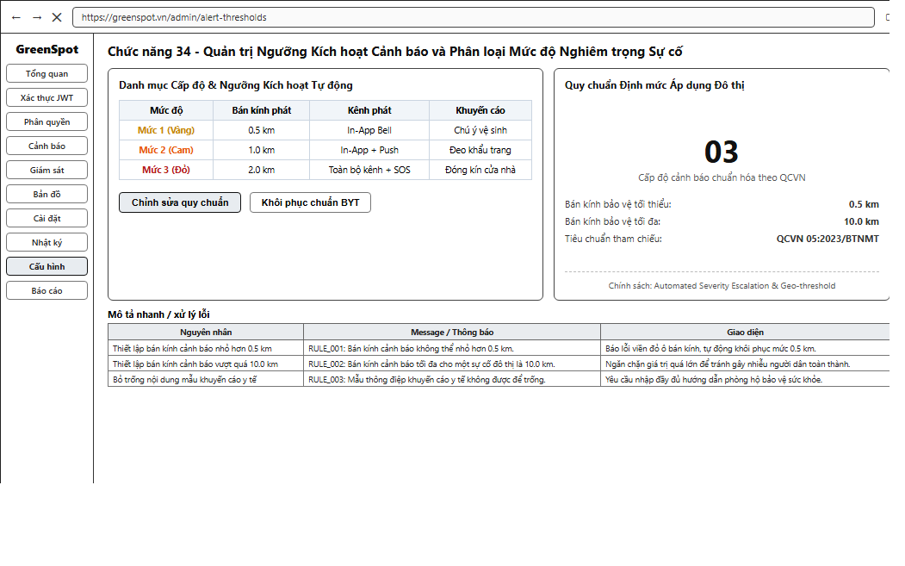
*Hình 4.34: Giao diện phác thảo Quản trị Ngưỡng Kích hoạt Cảnh báo và Phân loại Mức độ Nghiêm trọng Sự cố*

*Bảng 4.34.1: Đặc tả thành phần giao diện chức năng 34 (Quản trị ngưỡng kích hoạt cảnh báo)*
| Mã Phần Tử UI | Tên Thành Phần Giao Diện | Kiểu Điều Khiển UI | Chức Năng & Tương Tác Nghiệp Vụ |
| :--- | :--- | :--- | :--- |
| `CFG_TBL_THRESHOLDS` | Bảng danh mục cấp độ cảnh báo | Data Table | Liệt kê các mức: Vàng, Cam, Đỏ kèm bán kính phát tin và mô tả. |
| `CFG_NUM_RADIUS` | Ô nhập bán kính cảnh báo | Number Input (km) | Thiết lập bán kính gửi thông báo đẩy tính từ tâm điểm ô nhiễm. |
| `CFG_TXT_DEFAULT_ADVICE`| Ô nhập mẫu khuyến cáo y tế | Rich Text Area | Soạn sẵn mẫu thông điệp phòng hộ sức khỏe mặc định gửi cho dân. |
| `CFG_BTN_SAVE` | Nút lưu quy chuẩn | Primary Button | Cập nhật cấu hình ngưỡng cảnh báo vào CSDL. |
| `CFG_BTN_RESET` | Nút khôi phục mặc định | Outline Button | Đưa tham số về giá trị chuẩn mặc định ban đầu. |

- **Quy tắc kiểm tra và thông báo lỗi (Validation & Error Handling)**:

*Bảng 4.34.2: Quy tắc kiểm tra và thông báo lỗi chức năng 34 (Quản trị ngưỡng kích hoạt cảnh báo)*
| Trường Dữ Liệu / Tình Huống | Điều Kiện Ràng Buộc Kỹ Thuật | Mã Lỗi & Thông Điệp Phản Hồi Hiển Thị |
| :--- | :--- | :--- |
| Bán kính cảnh báo quá nhỏ | Giá trị bán kính tối thiểu là 0.5 km | `RULE_001`: Bán kính cảnh báo không thể nhỏ hơn 0.5 km. |
| Bán kính cảnh báo quá lớn | Giá trị bán kính tối đa là 10.0 km để tránh spam | `RULE_002`: Bán kính cảnh báo tối đa cho một sự cố đô thị là 10.0 km. |
| Mẫu khuyến cáo để trống | Bắt buộc có nội dung khuyến cáo cho người dân | `RULE_003`: Mẫu thông điệp khuyến cáo y tế không được để trống. |

---

#### Chức năng 35: Kênh Tiếp nhận Tín hiệu Cứu nạn Môi trường Khẩn cấp (SOS Environmental Alert Channel & Public Helpline Management)
- **Mục tiêu nghiệp vụ**: Thiết lập kênh tiếp nhận ưu tiên đặc biệt cho các tình huống sự cố môi trường khẩn cấp đe dọa trực tiếp đến tính mạng hoặc sức khỏe của cộng đồng (cháy bãi rác sinh khói độc hại, tràn hóa chất độc, vỡ cống ngập nước bẩn diện rộng); cho phép người dân gửi tín hiệu SOS khẩn cấp với thủ tục tinh giản tối đa; hỗ trợ quản trị viên kích hoạt ngay Banner cảnh báo đỏ chạy nổi bật trên đầu toàn bộ Cổng thông tin.
- **Tác nhân (Actor)**: Người dân phát hiện nguy cấp, Ban trực ban khẩn cấp môi trường đô thị.
- **Tiền điều kiện**: Người dân có kết nối mạng; đường dây tiếp nhận khẩn cấp trực tuyến 24/7.
- **Hậu điều kiện**: Sự cố SOS được gán cờ `CRITICAL` và đẩy lên đầu bảng điều khiển trực ban; khi kích hoạt, Banner khẩn cấp xuất hiện trên toàn bộ các trang của hệ thống.
- **Quy trình xử lý nghiệp vụ (Workflow)**:
  1. Người dân phát hiện sự cố nguy cấp, bấm vào nút đỏ nổi bật "Báo Cáo Sự Cố Khẩn Cấp (SOS)" trên giao diện web.
  2. Form SOS tinh gọn xuất hiện: Tự động lấy tọa độ vị trí hiện tại, yêu cầu nhập số điện thoại liên hệ khẩn và chọn nhanh loại sự cố (Cháy độc / Tràn hóa chất / Nước ô nhiễm).
  3. Người dân bấm "Gửi Tín Hiệu SOS Khẩn Cấp".
  4. Hệ thống lập tức kích hoạt chuông cảnh báo âm thanh và pop-up nhấp nháy trên màn hình trực ban của Cán bộ quản lý.
  5. Cán bộ trực ban xác minh nhanh thông tin và bấm nút gạt "Kích hoạt Banner Khẩn Cấp Toàn Cổng Thông Tin" để ngay lập tức toàn bộ người dân đang truy cập website đều nhìn thấy thông báo nguy hiểm màu đỏ ở đầu trang.
- **Luồng thay thế (Alternative Flow)**:
  - Gọi điện trực tiếp hotline SOS: Người dân bấm nút "Gọi Ngay Hotline Khẩn Cấp", thiết bị tự động kích hoạt cuộc gọi đến tổng đài trực ban môi trường 1022 / 114.
- **Luồng ngoại lệ (Exception Flow)**:
  - Gửi tin SOS giả mạo / spam: Hệ thống ghi nhận số điện thoại và địa chỉ IP; nếu một số điện thoại gửi quá 2 tin SOS trong 5 phút mà không bắt máy xác minh, hệ thống tự động đưa vào danh sách hạn chế (Blacklist).
- **Mô tả thành phần giao diện (UI Specification)**:
  - Nút SOS đỏ nhấp nháy nổi bật góc dưới màn hình; Biểu mẫu gửi SOS siêu tốc; Màn hình trực ban khẩn cấp của cán bộ kèm âm thanh cảnh báo; Khung hiển thị Banner đỏ chạy chữ cảnh báo (Emergency Broadcast Banner) trên đầu trang chủ.

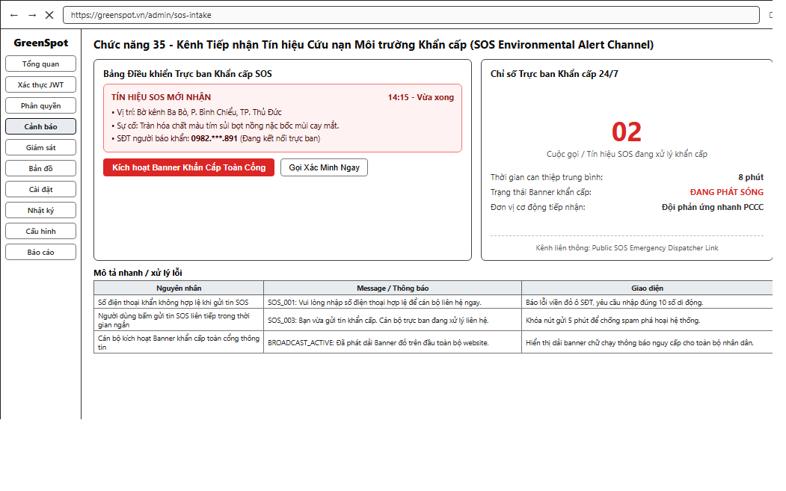
*Hình 4.35: Giao diện phác thảo Kênh Tiếp nhận Tín hiệu Cứu nạn Môi trường Khẩn cấp (SOS Environmental Alert Channel)*

*Bảng 4.35.1: Đặc tả thành phần giao diện chức năng 35 (Kênh cứu nạn môi trường khẩn cấp SOS)*
| Mã Phần Tử UI | Tên Thành Phần Giao Diện | Kiểu Điều Khiển UI | Chức Năng & Tương Tác Nghiệp Vụ |
| :--- | :--- | :--- | :--- |
| `SOS_BTN_TRIGGER` | Nút khẩn cấp SOS | Floating Danger Button (Pulsing) | Nút màu đỏ nổi bật nhấp nháy trên giao diện người dân. |
| `SOS_FORM_QUICK` | Form khai báo khẩn cấp | Modal Popup Window | Form rút gọn chỉ gồm: Vị trí tự động, Số điện thoại và Tùy chọn sự cố. |
| `SOS_DASH_ALERT` | Bảng tiếp nhận trực ban | Live Alert Board | Dành cho cán bộ: Danh sách tin SOS đến theo thời gian thực kèm âm thanh. |
| `SOS_SWT_BROADCAST` | Công tắc phát Banner toàn hệ thống | Big Red Switch | Kích hoạt dải banner cảnh báo nguy hiểm chạy trên đầu cổng thông tin. |
| `SOS_BAR_TOP_BANNER` | Dải Banner cảnh báo khẩn cấp | Marquee Alert Banner | Banner nền đỏ chữ trắng chạy đầu trang cảnh báo nguy hại cho dân. |

- **Quy tắc kiểm tra và thông báo lỗi (Validation & Error Handling)**:

*Bảng 4.35.2: Quy tắc kiểm tra và thông báo lỗi chức năng 35 (Kênh cứu nạn môi trường khẩn cấp SOS)*
| Trường Dữ Liệu / Tình Huống | Điều Kiện Ràng Buộc Kỹ Thuật | Mã Lỗi & Thông Điệp Phản Hồi Hiển Thị |
| :--- | :--- | :--- |
| Số điện thoại khẩn không hợp lệ | Phải là số điện thoại Việt Nam 10 chữ số | `SOS_001`: Vui lòng nhập số điện thoại hợp lệ để cán bộ liên hệ xác minh ngay. |
| Chưa có tọa độ vị trí | Bắt buộc có tọa độ GPS để định vị điểm nguy cấp | `SOS_002`: Vui lòng cho phép định vị vị trí hiện tại của sự cố. |
| Gửi tin SOS quá dày | Giới hạn tối đa 1 tin SOS / 5 phút trên 1 SĐT | `SOS_003`: Bạn vừa gửi tin khẩn cấp. Cán bộ trực ban đang xử lý liên hệ. |

---

#### Chức năng 36: Trung tâm Kết xuất Bản tin Báo cáo Hiện trạng Môi trường Công khai (PDF/Excel) (Public Environmental Periodic Summary & Open Data Export Hub)
- **Mục tiêu nghiệp vụ**: Thúc đẩy chính sách dữ liệu mở (Open Data) và minh bạch hóa thông tin môi trường: Cung cấp trung tâm cho phép người dân, cơ quan báo chí, sinh viên và các nhà nghiên cứu tự do tải về các bản tin báo cáo hiện trạng môi trường đô thị theo tuần/tháng/quý dưới dạng tệp PDF thiết kế chuyên nghiệp hoặc tệp bảng tính Excel (.xlsx) chứa dữ liệu thô phục vụ nghiên cứu; tự động ẩn toàn bộ thông tin cá nhân để bảo vệ quyền riêng tư công dân.
- **Tác nhân (Actor)**: Toàn thể nhân dân, Phóng viên báo chí, Nhà nghiên cứu, Quản trị viên.
- **Tiền điều kiện**: Dữ liệu sự cố và cảnh báo của kỳ báo cáo đã được chốt và tổng hợp trong bảng `reports`.
- **Hậu điều kiện**: Hệ thống tạo và trả về tệp PDF hoặc Excel tải xuống máy tính người dùng; ghi nhận nhật ký lượt tải công khai.
- **Quy trình xử lý nghiệp vụ (Workflow)**:
  1. Người dân truy cập trang "Trung Tâm Dữ Liệu Mở & Bản Tin Môi Trường" trên Cổng thông tin.
  2. Chọn kỳ báo cáo cần tải về: Chọn Tháng/Năm hoặc chọn khoảng thời gian tùy biến; chọn phạm vi (Toàn thành phố hoặc Quận cụ thể).
  3. Chọn định dạng tải về mong muốn:
     - (a) **Tải Bản Tin Môi Trường PDF**: Tệp PDF được trình bày trang trọng, có biểu đồ phân tích, tóm tắt diễn biến các điểm nóng môi trường và khuyến nghị cộng đồng.
     - (b) **Tải Dữ Liệu Mở Excel (.xlsx)**: Bảng tính chứa danh sách các sự cố môi trường đã xảy ra (chỉ chứa loại rác, tọa độ, địa chỉ, trạng thái, đã loại trừ tên/SĐT người báo).
  4. Người dân bấm nút "Tải Tệp Ngay".
  5. Trình duyệt tự động tải tệp tin về thiết bị trong vài giây.
- **Luồng thay thế (Alternative Flow)**:
  - Xem trực tuyến trước khi tải (Preview): Người dùng bấm "Xem trước tài liệu" để đọc nhanh nội dung bản tin PDF trực tiếp trên trình duyệt mà không cần tải về máy.
- **Luồng ngoại lệ (Exception Flow)**:
  - Kỳ báo cáo chưa chốt số liệu: Nếu người dùng chọn tháng hiện tại chưa kết thúc, hệ thống hiển thị thông báo "Dữ liệu đang cập nhật" và cho phép tải bản tin sơ bộ tạm thời.
- **Mô tả thành phần giao diện (UI Specification)**:
  - Trang trung tâm dữ liệu mở sạch sẽ, dễ dùng: Bộ lọc thời gian và khu vực; Khung thẻ giới thiệu bản tin tháng mới nhất (Ảnh bìa thumbnail, Tên bản tin, Dung lượng tệp, Ngày xuất bản); Nút bấm "Tải Bản Tin PDF" (màu đỏ) và nút "Tải Bảng Dữ Liệu Excel" (màu xanh lá).

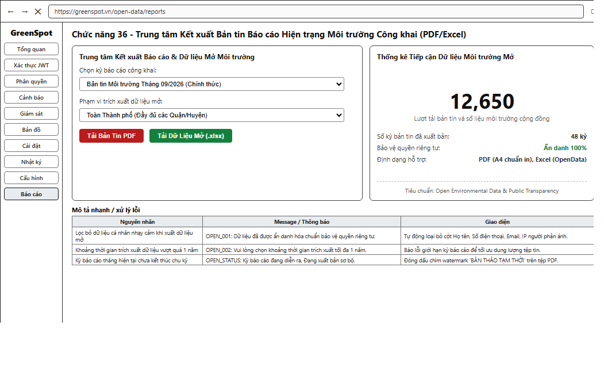
*Hình 4.36: Giao diện phác thảo Trung tâm Kết xuất Bản tin Báo cáo Hiện trạng Môi trường Công khai (PDF/Excel)*

*Bảng 4.36.1: Đặc tả thành phần giao diện chức năng 36 (Trung tâm kết xuất bản tin môi trường công khai)*
| Mã Phần Tử UI | Tên Thành Phần Giao Diện | Kiểu Điều Khiển UI | Chức Năng & Tương Tác Nghiệp Vụ |
| :--- | :--- | :--- | :--- |
| `EXP_DDL_PERIOD` | Chọn kỳ báo cáo | Dropdown Select | Chọn Tháng/Quý/Năm cần trích xuất báo cáo môi trường. |
| `EXP_DDL_DISTRICT` | Chọn phạm vi địa bàn | Dropdown Select | Chọn Toàn Thành phố hoặc một Quận/Huyện cụ thể. |
| `EXP_BTN_DOWNLOAD_PDF` | Nút tải bản tin PDF | Action Button (PDF Icon) | Kết xuất và tải về tệp báo cáo bản tin định dạng PDF in ấn chuẩn. |
| `EXP_BTN_DOWNLOAD_XLS` | Nút tải dữ liệu mở Excel | Action Button (Excel Icon) | Tải bảng tính .xlsx chứa dữ liệu ô nhiễm đã ẩn danh hóa. |
| `EXP_PREVIEW_MODAL` | Khung xem trước tài liệu | PDF Viewer Modal | Xem trực tiếp tài liệu trên trình duyệt trước khi tải về. |

- **Quy tắc kiểm tra và thông báo lỗi (Validation & Error Handling)**:

*Bảng 4.36.2: Quy tắc kiểm tra và thông báo lỗi chức năng 36 (Trung tâm kết xuất bản tin môi trường công khai)*
| Trường Dữ Liệu / Tình Huống | Điều Kiện Ràng Buộc Kỹ Thuật | Mã Lỗi & Thông Điệp Phản Hồi Hiển Thị |
| :--- | :--- | :--- |
| Bảo vệ quyền riêng tư (Privacy) | Tuyệt đối loại bỏ các cột Họ tên, SĐT, Email, IP người báo cáo | `OPEN_001`: Dữ liệu đã được ẩn danh hóa chuẩn bảo vệ quyền riêng tư. |
| Khoảng thời gian quá dài | Không cho phép xuất vượt quá 12 tháng liên tục trên 1 tệp | `OPEN_002`: Vui lòng chọn khoảng thời gian trích xuất tối đa 1 năm. |
| Không có dữ liệu trong kỳ | Khoảng thời gian chọn không ghi nhận điểm cảnh báo nào | `OPEN_003`: Không có dữ liệu cảnh báo ô nhiễm trong kỳ báo cáo đã chọn. |

---

## VI. KẾT LUẬN & ĐÁNH GIÁ TÍNH KHẢ THI PHÂN HỆ MỚI
1. **Hoàn toàn khả thi & Dễ lập trình (100% Practical)**:
   - Toàn bộ phân hệ của **Bùi Nguyễn Minh Quân** (Chức năng 25 → 36) được thiết kế dựa trên các công nghệ web cơ bản, quen thuộc: Biểu mẫu form nhập liệu, bảng hiển thị dữ liệu có phân trang, thư viện bản đồ số Leaflet mã nguồn mở (cực nhẹ và dễ tích hợp), biểu đồ thống kê Chart.js và các nút tải tệp Excel/PDF thông dụng.
   - Không đòi hỏi bất kỳ thuật toán điều phối xe cộ phức tạp, không liên quan đến ký số phần cứng PKI USB-token hay các bài toán tối ưu lộ trình vệ sinh khó khăn.
2. **Khớp nối 100% CSDL hiện hữu**:
   - Tất cả 12 chức năng đều tận dụng trực tiếp các bảng CSDL đã được thiết kế sẵn trong backend: `users`, `user_sessions`, `refresh_tokens`, `roles`, `permissions`, `audit_logs`, `notifications`, `incidents`, `incident_status_histories`, `reports`, `system_configs`, `waste_categories`. Không cần phải tạo thêm các bảng vận tải hay biên bản xử phạt cồng kềnh.
3. **Phân định ranh giới rõ ràng, 0% chồng chéo**:
   - **Nguyễn Thành Đạt (01 → 12)**: Tập trung tạo kênh cho người dân gửi thông tin và thu thập bằng chứng hiện trường ban đầu.
   - **Huỳnh Anh Tú (13 → 24)**: Tập trung vào mảng tương tác cộng đồng, tích lũy điểm thưởng xanh, đổi quà và các phong trào tình nguyện.
   - **Bùi Nguyễn Minh Quân (25 → 36)**: Giữ vai trò Nhóm Trưởng đảm bảo an ninh hệ thống, xây dựng Cổng thông tin Cảnh báo Môi trường và Giám sát Công khai Minh bạch phục vụ nhân dân.
   - **Lê Anh Tuấn (37 → 48)**: Đảm nhiệm mảng phân tích dữ liệu chuyên sâu, mô hình thuật toán AI và dự báo nguy cơ ngập lụt đô thị.
4. **Chuẩn mực báo cáo học thuật vượt trội**:
   - Tài liệu được xây dựng với cấu trúc chi tiết, văn phong khoa học chuẩn mực theo đúng yêu cầu của đồ án tốt nghiệp, tự tin bảo vệ xuất sắc trước hội đồng chấm điểm.

